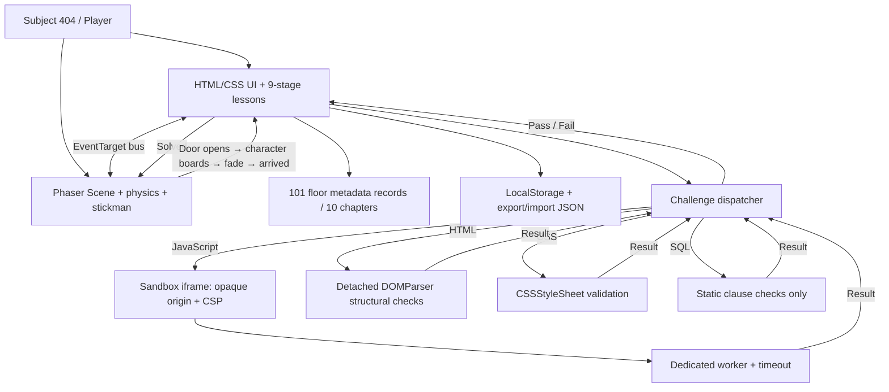
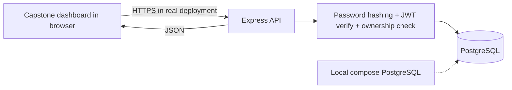
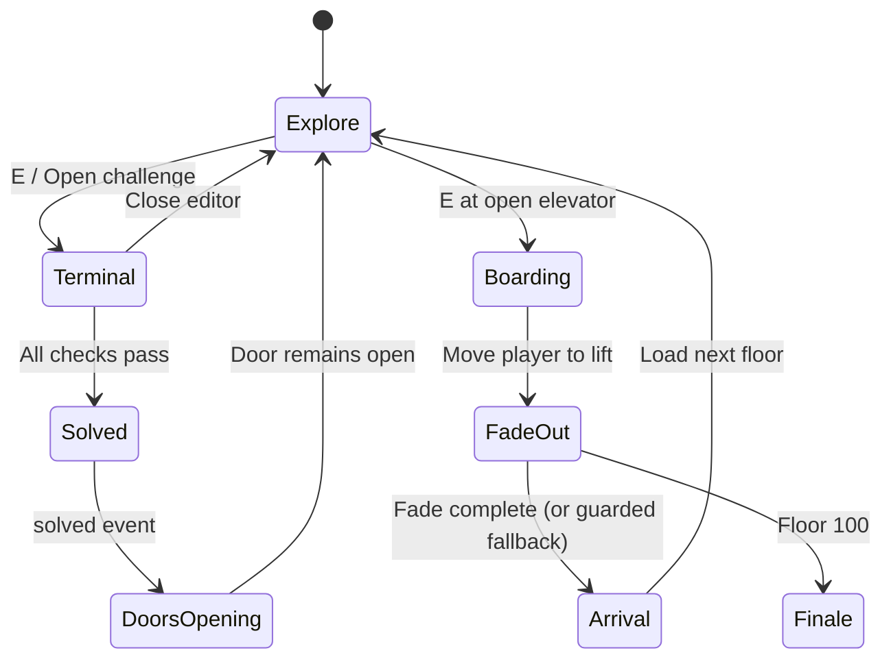

# CodeBreak v1 — Architecture and Trust Boundaries

## Main runtime

### Critical security boundaries
- JavaScript solutions **never execute in the trusted main page**; they use nested opaque-origin iframe + worker. Worker is destroyed on result/timeout. Sandbox escape resistance has **not** undergone a professional security audit.
- HTML previews use empty iframe sandbox flags (no scripts, no same-origin) with restrictive CSP. HTML checks use an inert document parser.
- CSS checks parse declarations using browser CSSOM; no arbitrary user CSS is attached to the trusted DOM. Preview CSP restricts resource access.
- SQL exercises are **static checks only**: they do not connect to a real database or guarantee semantic correctness.
- Browser floor-completion records are user-editable and cannot certify abilities or unlock server authorizations.

## Separate capstone: Real full stack

Real capstone architecture: `capstone/client/` HTML/CSS/JS, `capstone/server/src/app.js` Express routes, `security.js` scrypt and jose JWT, `db.js` pg connection pool, `sql/001_initial.sql` schema. Production launch requires TLS, cloud secrets, backups, durable rate limiting and audits.

## Game state machine

**Do not** jump floors on clicking Enter elevator. UI requests boarding; the Phaser scene owns the animation; only its `game:elevator:arrived` event advances the logical floor.

## Curriculum, tests, and status
Ten 10-floor chapters + prologue; floor records are independent of scene physics. A *chapter core* is awarded by passing floor N*10. Placement tests open earlier lessons without awarding mastery. The completed capstone is a separate external learning objective. User-visible game achievement is not a recognized certification.
