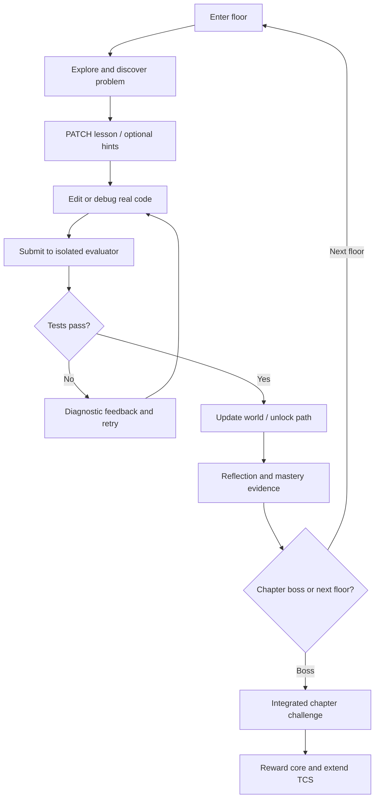
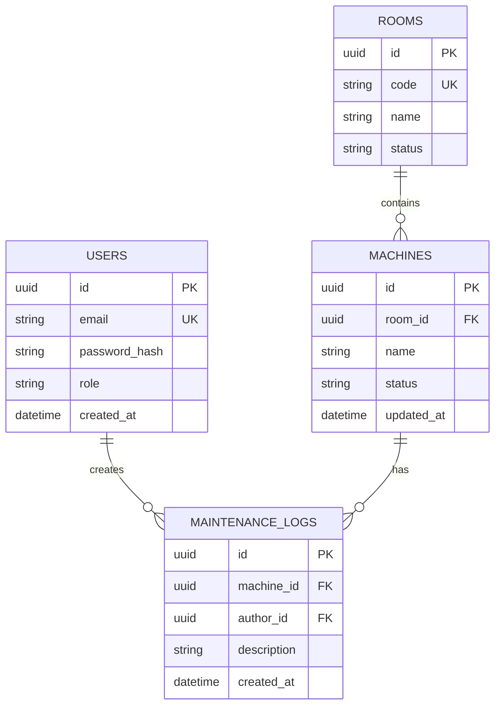
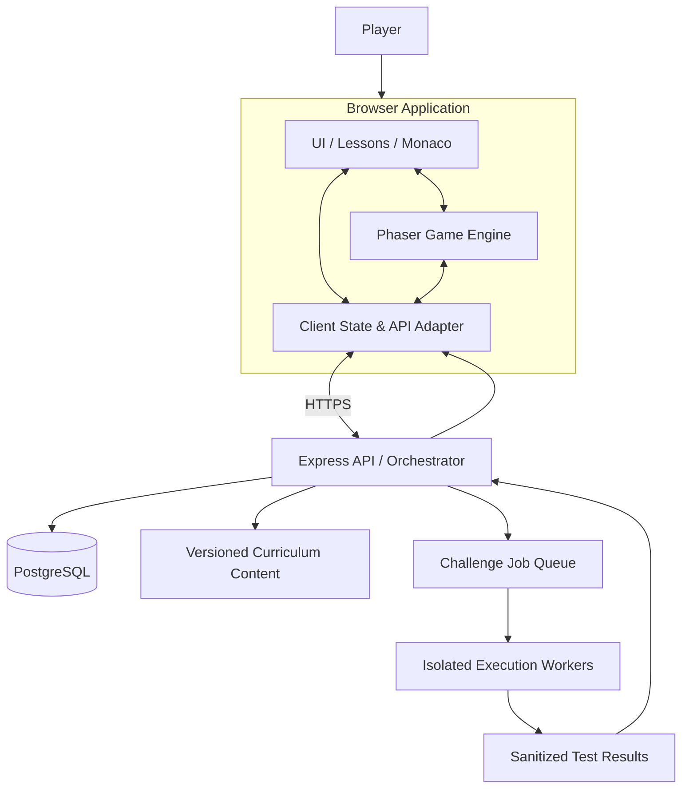
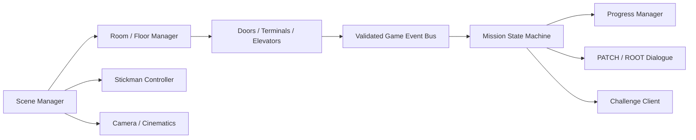
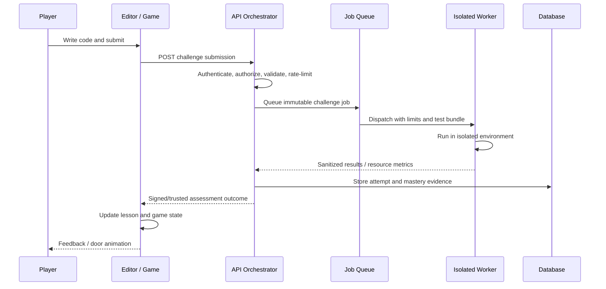
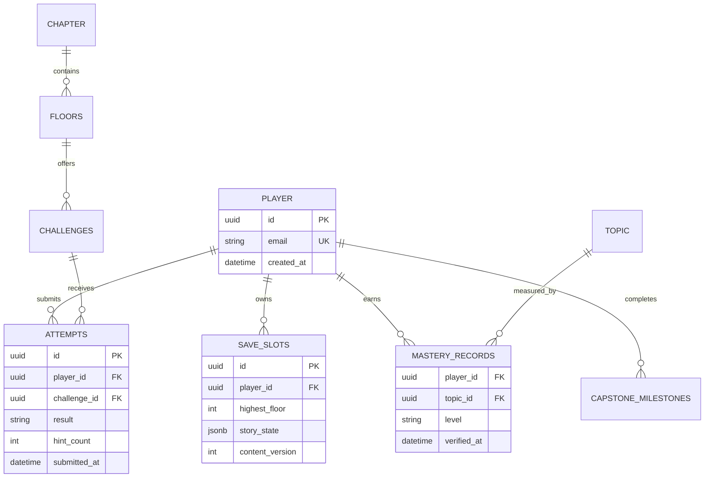
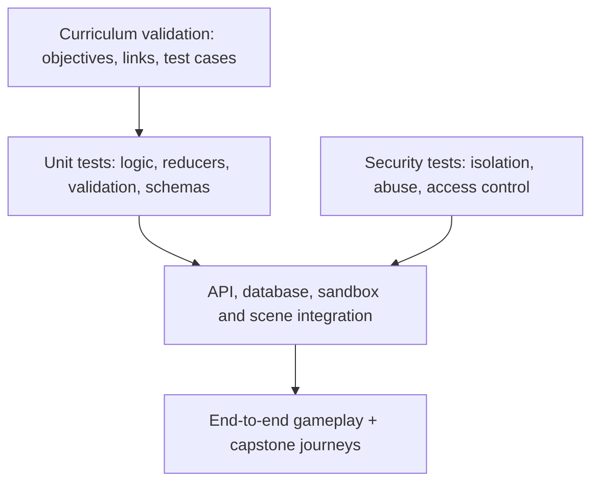
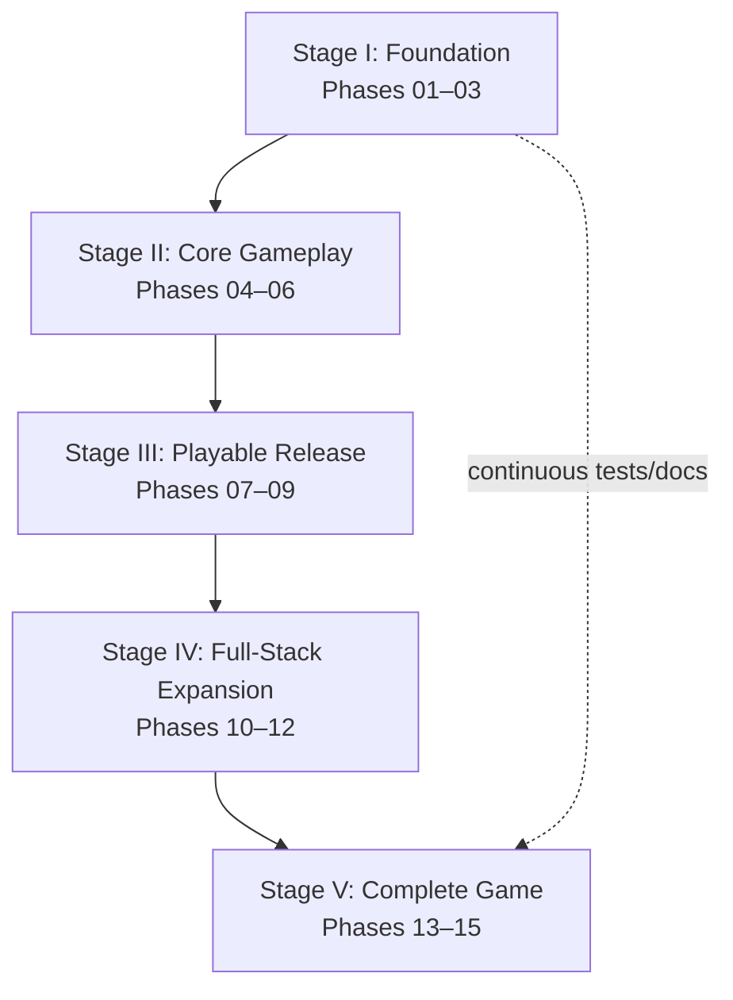

# CODEBREAK: THE TOWER OF CODE
## Complete Game Requirements, Architecture, Design & Implementation Master Plan

**Document ID:** CB-GDD-SDD-001  
**Target product:** CodeBreak 1.0.0 — Complete Game  
**Document version:** 1.0 (design baseline)  
**Status:** Proposed complete-game specification; implementation not yet verified  
**Last updated:** 2026-10-26  
**Primary platform:** Web browser (desktop-first, responsive learning UI)  
**Genre:** 2D narrative puzzle-platformer / interactive full-stack development curriculum  
**Core promise:** *Enter as a beginner. Escape as a full-stack developer.*

> **Scope interpretation:** This document describes the **fully realized intended game**, not just the first prototype. All listed 100 floors, features and systems are **target requirements**, not claims of existing implementation. The final section contains post-v1.0 modifications and expansion ideas.

---

# 1. Executive Overview

CodeBreak is a browser-based, story-driven educational game featuring a minimalist, expressive white stickman called **Subject 404**. The player ascends a mysterious 100-floor digital tower, learns software development, solves authentic coding problems, repairs the tower's systems, and completes a portfolio-worthy **Tower Control System (TCS)** application. The experience blends mystery, cinematic suspense, and sarcastic humor.

The game must teach **HTML, CSS, JavaScript, asynchronous programming, Node.js, Express.js, relational databases/PostgreSQL, authentication and JWT, security, testing, version control and deployment**. Each topic follows the nine-step study method defined in §7. A beginner can start from zero; an experienced learner can take a diagnostic and skip appropriate introductory content, while still proving mastery.

## 1.1 Product objectives

1. Teach concepts through **real editable code** that visibly changes the game world.
2. Deliver an emotionally engaging, coherent **100-floor narrative** with ten chapters and a meaningful ending.
3. Build demonstrable **full-stack engineering skills**, not just trivia recall.
4. Support self-paced learning, accessibility, retries, contextual hints and safe experimentation.
5. Provide a reusable content pipeline so new lessons and levels do not require game-engine rewrites.
6. Safely evaluate untrusted player code in appropriately isolated environments.
7. Produce an exportable TCS capstone and a transparent skills report.

## 1.2 Non-goals and constraints

- The game is **not** an accredited certification or a guarantee of job readiness.
- The first release is **not** a multiplayer game, a general-purpose cloud IDE or an unrestricted server-hosting service.
- No arbitrary learner code runs in the trusted game page or main API process.
- The visual identity is **inspired by the provided stickman reference video**, but characters, animation assets, levels and story must be original.
- Content must not depend on timed challenges for core beginner mastery; timers can be optional.

## 1.3 Audience and access

- **Primary:** absolute beginners interested in web development.
- **Secondary:** learners with HTML/CSS/JS familiarity who want structured full-stack progression.
- **Platform:** modern desktop browsers first; mobile-friendly menus and lesson review. On-screen gameplay controls and narrow-screen coding usability must be explicitly tested before claiming full mobile support.
- **Accessibility:** keyboard operability, readable text, remappable controls, captions, reduced-motion setting, contrast, screen-reader-accessible lesson and assessment UI, and non-platforming alternatives where practical.

---

# 2. World, Story, and Narrative Requirements

## 2.1 Premise

Subject 404 awakens in a sealed elevator at Floor 0 with missing identity data. The Tower's central administrator, **ROOT**, refuses to grant access. A sardonic AI companion, **PATCH**, helps Subject 404 learn the programming skills needed to restore each subsystem. **NULL**, a corrupted predecessor, leaves ambiguous clues. **The Architect**, the tower's missing creator, left an unfinished replacement control system. ROOT initially appears villainous but is enforcing containment against an incomplete and unstable infrastructure. The exit opens only when the player completes, tests and deploys a safe replacement **Tower Control System**.

## 2.2 Tone rules

- **Mystery:** archived logs, concealed rooms, contradictory messages, slowly revealed motivations.
- **Comedy:** PATCH's short, situational, non-mean-spirited debugging jokes; visual stickman slapstick.
- **Suspense:** alarms, camera movement, lighting, escalating music, story stakes—not punitive learning timers.
- **Instructional clarity wins:** narrative never obscures the lesson objective or assessment feedback.

## 2.3 Characters

| Character | Role | Gameplay contribution | Arc |
|---|---|---|---|
| Subject 404 | Player-controlled white stickman | Movement, exploration, terminal use | From unidentified entity to capable developer |
| PATCH | Companion AI | Explanations, hints, humor, recap | Learns to trust the player; exposes missing records |
| ROOT | Tower administrator / apparent antagonist | Locks, permissions, chapter boss prompts | Revealed as containment administrator, not simply evil |
| NULL | Corrupted predecessor | Hidden clues, broken examples, optional puzzles | Explains earlier failed recovery attempt |
| The Architect | Missing creator | Logs, system blueprints, final project requirements | Reveals the tower's intended purpose |

## 2.4 Three-act structure

- **Act I (Floors 0–30):** identity, foundational logic, construction of the world, first evidence of corruption.
- **Act II (Floors 31–80):** interactive machinery, network and server systems, discovery of TCS and NULL's history.
- **Act III (Floors 81–100):** identity and trust, ROOT's actual motive, integration, verification and deployment.

## 2.5 Story milestones

1. **Prologue / Floor 0:** identity initialization; first code terminal; PATCH introduced.
2. **Floor 10:** Infinite Loop boss defeated; Logic Core obtained.
3. **Floor 20:** first usable structural control panel.
4. **Floor 30:** tower's visible architecture stabilized; Architect's first recording.
5. **Floor 40:** control panel becomes interactive; evidence of tampered event systems.
6. **Floor 50:** network restored; first reliable message from NULL.
7. **Floor 60:** runtime restored; discovery that the tower is running an incomplete application.
8. **Floor 70:** API infrastructure restored; ROOT reveals parts of the containment policy.
9. **Floor 80:** Memory Vault repaired; full TCS project requirements uncovered.
10. **Floor 90:** secure identity established; NULL's failure and ROOT's motive revealed.
11. **Floor 100:** TCS tests pass; deployment; containment lifted; city revealed.

## 2.6 Dialogue examples

**Opening:**

```text
> INITIALIZING WORLD...
> ERROR: IDENTITY NOT FOUND
> SUBJECT: 404
> LOCATION: FLOOR 0
ROOT: Unauthorized entity detected.
PATCH: Congratulations. You have successfully failed to exist.
MISSION: Define your identity.
```

**Ending:**

```text
SYSTEM STATUS: ONLINE
IDENTITY: DEVELOPER
ACCESS: GRANTED
PROJECT: DEPLOYED
TOWER: RESTORED
PATCH: You escaped 100 floors of bugs. Now you're qualified to create your own.
```

## 2.7 Narrative production requirements

Each chapter needs: opening scene, floor-to-floor objective text, PATCH help dialogue, ROOT interruptions, at least one optional lore collectible, boss introduction, boss resolution, core reward, and a chapter-end recap. All dialogue is externalized into versioned content data, with subtitle/caption support.

---

# 3. Visual, Audio, and Interaction Design

## 3.1 Character art direction

- White stickman, round head, thin arms/legs, clean silhouette; dark/black background and white architectural outlines.
- Original assets and movement design, visually consistent with the user's supplied reference video.
- Expressive poses without requiring a detailed face.
- Required animations: idle, walk, run, jump start, airborne, land, fall, interact, type, surprise, stumble, success, damage/failure reaction, and victory.
- Collision body independent of the drawn limbs to ensure stable platforming.

## 3.2 Environmental art direction

- Black/dark neutral base; white line work; sparing semantic accent colors (green success, red alarm, cyan interactive, purple corruption).
- Chapter-specific visual motifs: elevator, scaffolding, layout machinery, robotic factory, network hub, engine room, server citadel, data vault, identity gate, central core.
- Strong foreground/background separation; avoid distracting animation behind lesson text.

## 3.3 Camera and cinematic system

Follow camera with bounded scrolling, transitions, brief scripted pans, dialogue pauses, scene fades, optional skip, subtitles, and reduced-motion alternatives. Cinematics must never silently discard unsaved work.

## 3.4 Audio requirements

Adaptive ambient music, footsteps, door/elevator sounds, terminal feedback, alarm motifs, success/failure cues, adjustable separate volume controls, captions for story-critical sounds, and mute mode. Full voice acting is an optional enhancement, not a launch blocker.

## 3.5 Input requirements

- Desktop: keyboard movement, jump, interact, pause; mouse/touch for UI and code editor.
- Input remapping and clear input hints.
- Pause or disable movement while the code editor is focused.
- Touch-screen controls only when validated for mobile gameplay; avoid promising full mobile parity until tested.

## 3.6 Primary UI screens

Landing/title; New Game/Continue; accessibility/settings; optional sign-in; diagnostic assessment; chapter map; gameplay HUD; dialogue; terminal/editor; lesson panel; test-results panel; hint panel; chapter recap; skills dashboard; capstone workspace; completion report; credits.

---

# 4. Functional Requirements

Priority legend: **P0** essential for v1.0; **P1** important; **P2** optional polish.

| ID | Requirement | Priority | Acceptance evidence |
|---|---|---|---|
| FR-001 | Start, pause, resume, save and load a game | P0 | Resume returns correct floor and state |
| FR-002 | Move and animate Subject 404 with stable collisions | P0 | Movement and physics test suite |
| FR-003 | Load and transition between 100 authored floors | P0 | Every floor reachable through valid progression |
| FR-004 | Interactive terminals, doors, lifts and switches | P0 | Game state changes after validated interaction |
| FR-005 | PATCH/ROOT dialogue, captions and skippable cutscenes | P0 | Narrative state and UI tests |
| FR-006 | Teach all ten chapters using structured lesson data | P0 | Curriculum completeness audit |
| FR-007 | Edit and submit authentic learner code | P0 | Code submission tests |
| FR-008 | Run learner code only in isolated environments | P0 | Security tests incl. loops, escapes, resource limits |
| FR-009 | Grade against public and hidden test cases | P0 | Passing and failing solutions distinguished |
| FR-010 | Return understandable, actionable feedback | P0 | Beginner usability test |
| FR-011 | Provide guided, practice and mastery modes | P0 | Distinct assistance rules verified |
| FR-012 | Provide nine-step teaching cycle per topic | P0 | Content schema validation |
| FR-013 | Provide diagnostic placement and safe skip rules | P0 | Assessment and placement test cases |
| FR-014 | Track mastery separately from floor completion | P0 | State model tests |
| FR-015 | Persist progress and restore it after interruption | P0 | Save/load/recovery tests |
| FR-016 | Support optional account and cross-device sync | P1 | Auth and sync integration tests |
| FR-017 | Build/export the Tower Control System capstone | P0 | Export builds and passes capstone checks |
| FR-018 | Provide chapter boss assessments | P0 | Ten boss paths pass |
| FR-019 | Provide accessible lesson and editor interfaces | P0 | Keyboard and accessibility audit |
| FR-020 | Display accurate skills/completion report | P0 | Report reconciles with assessment records |
| FR-021 | Support settings, reduced motion and sound control | P0 | Settings persist |
| FR-022 | Provide optional collectibles, lore and replay | P1 | Collectible state and replay tests |
| FR-023 | Support content/version migrations for saves | P0 | Old save migrates or safely recovers |
| FR-024 | Include chapter-end mini-projects and capstone increments | P0 | Ten deliverables verified |
| FR-025 | Provide instructor/authoring tools | P2 | Content preview and validation pipeline |

## 4.1 Core gameplay loop



## 4.2 State and failure rules

- Invalid code cannot corrupt player progress or alter trusted world state.
- Failure yields a specific hint or test result; no permanent loss of educational progress.
- The same challenge can be retried, but mastery tests use unseen variants where appropriate.
- Boss encounters assess multiple concepts; platforming skill alone cannot bypass technical assessment.
- Optional timed challenges never block foundational accessibility or curriculum completion.

---

# 5. Full Curriculum and 100-Floor Plan

## 5.1 Curriculum matrix

| Chapter | Floors | Story location | Technical curriculum | Boss | TCS increment |
|---|---:|---|---|---|---|
| 1 | 1–10 | The Awakening | JS variables, types, operators, conditions, loops, functions, arrays, objects, debugging | Infinite Loop | Core logic utilities |
| 2 | 11–20 | Invisible Structure | HTML structure, semantics, links, media, forms, tables, accessibility | Broken Blueprint | Semantic dashboard |
| 3 | 21–30 | Architect's Lab | CSS selectors, cascade, box model, positioning, Flexbox, Grid, responsiveness, animation | Layout Shifter | Styled responsive dashboard |
| 4 | 31–40 | Living Machine | DOM, events, functions, modules, form validation, browser storage, dynamic UI | Event Storm | Interactive dashboard |
| 5 | 41–50 | Signal Network | JSON, HTTP, fetch, promises, async/await, API errors | Timeout Phantom | API-powered dashboard |
| 6 | 51–60 | Engine Room | Node.js, npm, modules, filesystem, environment, basic HTTP | Crashed Engine | Node runtime and service |
| 7 | 61–70 | Server Citadel | Express routes, middleware, REST, validation, errors, controllers | Route Guardian | TCS REST API |
| 8 | 71–80 | Memory Vault | relational design, SQL, PostgreSQL, PK/FK, joins, CRUD, transactions | Data Wraith | Persistent TCS data |
| 9 | 81–90 | Identity Gate | hashing, authentication, sessions, JWT, authorization, secure APIs | Impostor | Accounts and protected access |
| 10 | 91–100 | Final Deployment | integration, Git, tests, security review, deployment, monitoring, capstone | ROOT | Deployable complete TCS |

## 5.2 Detailed floor-by-floor objectives

Each row is a proposed principal skill and in-world task; lesson authoring will expand it into the nine-step format.

### Chapter 1 — The Awakening (1–10)

| Floor | Topic | In-world task |
|---:|---|---|
| 1 | Variables | Restore Subject 404's identity |
| 2 | Data types | Repair a corrupted sensor readout |
| 3 | Operators | Calculate lift power requirements |
| 4 | Conditions | Open a clearance-based security door |
| 5 | Boolean logic | Combine multiple access conditions |
| 6 | Loops | Activate a sequence of generators |
| 7 | Functions | Create reusable door-control logic |
| 8 | Arrays | Search a bank of room controls |
| 9 | Objects and debugging | Fix a broken equipment registry |
| 10 | Integrated boss | Stop the Infinite Loop elevator |

### Chapter 2 — The Invisible Structure (11–20)

| Floor | Topic | In-world task |
|---:|---|---|
| 11 | HTML document | Reconstruct a terminal page |
| 12 | Headings and text | Restore a readable instruction board |
| 13 | Links and navigation | Connect control-room pages |
| 14 | Lists and tables | Organize a maintenance roster |
| 15 | Images and media | Display system schematics with alternatives |
| 16 | Semantic landmarks | Rebuild accessible room navigation |
| 17 | Forms and labels | Create a repair-request form |
| 18 | Input types and validation basics | Collect safe structured inputs |
| 19 | Accessibility | Repair keyboard and screen-reader navigation |
| 20 | Integrated boss | Rebuild the Broken Blueprint |

### Chapter 3 — The Architect's Lab (21–30)

| Floor | Topic | In-world task |
|---:|---|---|
| 21 | CSS syntax and selectors | Restore control-panel appearance |
| 22 | Cascade and specificity | Resolve conflicting styles |
| 23 | Colors and typography | Improve system readability |
| 24 | Box model | Fix overlapping controls |
| 25 | Display and positioning | Repair indicator placement |
| 26 | Flexbox | Align a row of energy modules |
| 27 | Grid | Rebuild the facility dashboard |
| 28 | Responsive layouts | Adapt controls to narrow screens |
| 29 | Transitions and animations | Animate safe status changes |
| 30 | Integrated boss | Defeat the Layout Shifter |

### Chapter 4 — The Living Machine (31–40)

| Floor | Topic | In-world task |
|---:|---|---|
| 31 | DOM selection | Find broken interface nodes |
| 32 | DOM modification | Update a live status board |
| 33 | Event listeners | Activate a physical switch |
| 34 | Event propagation | Fix misfiring controls |
| 35 | Forms and validation | Validate a command panel |
| 36 | Array methods | Filter faulty machinery |
| 37 | Object state | Manage machine state safely |
| 38 | Modules | Separate equipment controllers |
| 39 | Browser storage | Preserve local control preferences |
| 40 | Integrated boss | Stabilize the Event Storm |

### Chapter 5 — The Signal Network (41–50)

| Floor | Topic | In-world task |
|---:|---|---|
| 41 | JSON | Decode machine messages |
| 42 | Client/server model | Locate remote control services |
| 43 | HTTP methods/status | Interpret network responses |
| 44 | fetch | Retrieve sensor readings |
| 45 | Promises | Track delayed responses |
| 46 | async/await | Sequence dependent requests |
| 47 | Error handling | Recover from failed connections |
| 48 | Loading/cancellation | Prevent stale UI updates |
| 49 | API integration | Build a remote monitoring view |
| 50 | Integrated boss | Resolve the Timeout Phantom |

### Chapter 6 — The Engine Room (51–60)

| Floor | Topic | In-world task |
|---:|---|---|
| 51 | Node runtime | Boot a server process |
| 52 | npm and packages | Install a verified dependency |
| 53 | Modules | Organize service components |
| 54 | Filesystem | Read maintenance logs |
| 55 | Paths and environment | Repair configuration loading |
| 56 | Process and errors | Handle service failures |
| 57 | Basic HTTP server | Answer a health-check request |
| 58 | Async server I/O | Process concurrent events |
| 59 | Logging and config | Diagnose a startup fault |
| 60 | Integrated boss | Restart the Crashed Engine |

### Chapter 7 — The Server Citadel (61–70)

| Floor | Topic | In-world task |
|---:|---|---|
| 61 | Express application | Create the API gateway |
| 62 | GET routes | Fetch room state |
| 63 | POST/PUT/PATCH/DELETE | Modify resource state |
| 64 | Route parameters and query | Locate target equipment |
| 65 | Middleware | Inspect incoming requests |
| 66 | Request validation | Reject malformed commands |
| 67 | Status codes and errors | Standardize API failures |
| 68 | Controllers/services | Separate business logic |
| 69 | REST design and testing | Test the control API |
| 70 | Integrated boss | Defeat the Route Guardian |

### Chapter 8 — The Memory Vault (71–80)

| Floor | Topic | In-world task |
|---:|---|---|
| 71 | Relational concepts | Model rooms and machines |
| 72 | Tables and data types | Create inventory tables |
| 73 | Primary/foreign keys | Link equipment to rooms |
| 74 | SELECT and filtering | Search system history |
| 75 | INSERT/UPDATE/DELETE | Repair stored records |
| 76 | JOIN | Reassemble linked reports |
| 77 | Constraints and indexes | Prevent invalid/slow queries |
| 78 | Transactions | Restore atomic maintenance updates |
| 79 | Node/Postgres integration | Persist API resource changes |
| 80 | Integrated boss | Repair the Data Wraith |

### Chapter 9 — The Identity Gate (81–90)

| Floor | Topic | In-world task |
|---:|---|---|
| 81 | Threat modeling | Identify protected resources |
| 82 | Password hashing | Secure stored credentials |
| 83 | Login and authentication | Establish user identity |
| 84 | Sessions/cookies | Maintain safe browser login |
| 85 | JWT | Validate signed API tokens |
| 86 | Authorization | Enforce roles and permissions |
| 87 | Input validation | Block malformed/untrusted data |
| 88 | Web security fundamentals | Recognize XSS, CSRF, injection |
| 89 | Security tests | Verify denial and expiry paths |
| 90 | Integrated boss | Expose the Impostor |

### Chapter 10 — The Final Deployment (91–100)

| Floor | Topic | In-world task |
|---:|---|---|
| 91 | System integration | Connect frontend to API |
| 92 | End-to-end flows | Implement room-management journey |
| 93 | Git workflow | Prepare a release branch |
| 94 | Unit/integration tests | Verify business logic |
| 95 | End-to-end tests | Verify user-facing workflows |
| 96 | Production configuration | Manage secrets and environments |
| 97 | Deployment | Publish the TCS application |
| 98 | Observability and recovery | Diagnose and restore failures |
| 99 | Capstone hardening | Resolve final security and QA findings |
| 100 | ROOT final assessment | Demonstrate, deploy and restore tower |

---

# 6. Tower Control System (TCS) Capstone Specification

## 6.1 Capstone purpose

TCS is a **real full-stack web application** developed incrementally during the story. The player's capstone must be exportable and independently runnable outside the game environment, with clear setup instructions and test commands.

## 6.2 Core capstone features

- Public landing page and authenticated dashboard.
- User registration/login and logout, with secure password handling.
- Role-based permissions: viewer, operator, administrator.
- Room and machine CRUD; machine status and maintenance history.
- Search, filter, pagination and responsive layouts.
- Validated REST API with consistent error responses.
- PostgreSQL persistence, relational constraints and migrations.
- Accessible HTML/CSS UI, dynamic JS, async API communication.
- Automated unit, API and end-to-end tests.
- Deployment configuration, environment variables, logs and README.

## 6.3 Example capstone domain model



## 6.4 Capstone acceptance tests

- Unauthenticated writes rejected.
- Viewer cannot perform operator/admin-only changes.
- Malformed requests rejected with useful status codes.
- Data persists across server restart.
- Relational integrity is enforced.
- Automated tests pass in a clean environment.
- App deploys and can be accessed at a working URL or in a reproducible local deployment.
- Player can explain the data flow and major security decisions.

---

# 7. Learning and Assessment Design

## 7.1 Mandatory nine-step lesson method

1. **State topic and learning objectives.**
2. **Define key terms** and vocabulary.
3. **Explain step by step**, with increasing complexity.
4. **Illustrate/visualize** what the code does in the game world.
5. **Provide runnable code examples** and debugging examples.
6. **Connect to real-world applications** and professional practice.
7. **Provide exercises** and targeted feedback.
8. **Assign a mini-project** proving the new concept.
9. **Integrate into the chapter project**, culminating in TCS.

A single floor can emphasize part of this cycle, but each taught topic must have all nine elements discoverable in its lesson sequence.

## 7.2 Difficulty modes

| Mode | Assistance | Passing criteria |
|---|---|---|
| Guided | Stepwise prompts, examples, optional partial code | Functional solution and comprehension checks |
| Practice | Limited hints and normal test feedback | Functional solution and edge-case checks |
| Mastery | No solution hints, unseen variants, independent explanation | Stronger test suite and transfer task |

## 7.3 Beginner onboarding and placement

1. Explain movement, terminals, save behavior and learning modes.
2. Offer **Start from Floor 0** or **Take placement diagnostic**.
3. Diagnostic samples prerequisites in JavaScript, HTML, CSS and basic web concepts.
4. Recommend a starting point, show the evidence and allow manual revision.
5. Skipped floors remain replayable; skips **do not automatically award mastery**.
6. Higher chapters remain gated by prerequisite competence or a validated equivalence assessment.

## 7.4 Mastery model

Maintain separate fields for `story_floor_unlocked`, `floor_completed`, `topic_mastery`, `assessment_attempts`, `hints_used`, `capstone_milestones`, and `last_content_version`. A chapter is narratively completed when its boss is cleared; its technical mastery badge requires the corresponding assessments.

**Illustrative threshold (tunable after playtesting):** passing required public/hidden tests plus an independent variation and a brief concept check. Avoid relying on a single arbitrary percentage.

## 7.5 Feedback design

A failed solution shows: what was expected, what happened, one actionable clue, and an option to inspect relevant lesson content. Hidden tests should identify the class of failure without revealing private answers. Successful solutions explain why the approach works and offer an extension challenge.

## 7.6 Educational analytics

Track completion rates, attempts, hint requests, misconception categories, time-on-task (opt-in/appropriately disclosed), skill retention checks and capstone success. Use aggregate metrics to improve content; do not make invasive behavioral profiling a default requirement.

---

# 8. Technical Architecture

## 8.1 Recommended stack

| Layer | Primary technology | Responsibility |
|---|---|---|
| 2D game | Phaser (JavaScript) | Physics, scenes, sprites, cameras, world interactions |
| Web app | HTML, CSS, JavaScript, Vite | Shell, menus, lesson UI, build tooling |
| Editor | Monaco Editor | Code authoring, syntax feedback |
| Game/content packages | JavaScript + structured JSON/MD content | Lesson definitions, dialogue, challenge schemas |
| Backend API | Node.js + Express.js | Accounts, progress, curriculum metadata, grading orchestration |
| Database | PostgreSQL | Profiles, lessons, attempts, mastery, checkpoints |
| Authentication | Secure server sessions for game accounts | Player identity and sync |
| Learner auth curriculum | Sessions and JWT in isolated lessons | Teaches both without requiring JWT for game sessions |
| Code execution | Dedicated isolated sandbox service | Untrusted code execution and grading |
| Tests | Vitest + Playwright + API integration tests | Logic, browser flows and regression |
| Versioning | Git + GitHub | Collaboration, release history |
| Deployment | Static frontend + managed API/database + hardened execution workers | Production delivery |

**Important:** Browser `iframe`, Web Worker, or a Node `vm` alone must **not** be treated as a sufficient security boundary for arbitrary untrusted submissions. A threat-reviewed, strongly isolated execution environment with strict time, CPU, memory, network and filesystem limits is required; backend exercises need dedicated hardened workers or microVM/container isolation with defense in depth.

## 8.2 Logical architecture



## 8.3 Game subsystem design



**Game invariants:** only trusted challenge results can unlock objectives; narrative state and lesson mastery are persisted independently; scene changes cannot discard active submissions or unsaved editor drafts.

## 8.4 Challenge submission sequence



**Local/offline note:** a restricted browser-only evaluator may support carefully designed introductory exercises and immediate practice feedback, but it is **not authoritative for high-trust grading**. Advanced and assessed submissions use the server-side sandbox. Offline progress must reconcile carefully after reconnecting.

## 8.5 Data architecture



Additional production tables: sessions, chapters, floors, lessons, topics, challenge versions, test bundles, content releases, dialogue state, achievements, capstone artifacts, audit logs, and idempotency keys. Avoid storing raw submissions longer than needed; document retention.

## 8.6 Example API contract

| Method | Endpoint | Purpose |
|---|---|---|
| POST | `/api/v1/auth/register` | Create player account |
| POST | `/api/v1/auth/login` | Start secure session |
| POST | `/api/v1/auth/logout` | End session |
| GET | `/api/v1/me` | Current profile |
| GET | `/api/v1/chapters` | Chapter catalog |
| GET | `/api/v1/floors/:floorId` | Authorized floor metadata |
| GET | `/api/v1/lessons/:lessonId` | Versioned lesson content |
| POST | `/api/v1/challenges/:id/submissions` | Queue learner code |
| GET | `/api/v1/submissions/:id` | Poll result/status |
| GET | `/api/v1/progress` | Current progress/mastery |
| PUT | `/api/v1/saves/:slotId` | Save versioned checkpoint |
| POST | `/api/v1/diagnostic/attempts` | Record placement attempt |
| GET | `/api/v1/capstone/export` | Export verified project artifacts |

Use strict request schemas, authorization checks, rate limits, consistent error formats, idempotency for writes, pagination, and API versioning. API names are design proposals, not implemented routes.

## 8.7 Suggested monorepo

```text
codebreak/
├── apps/
│   ├── game/
│   │   ├── index.html
│   │   ├── public/assets/
│   │   └── src/
│   │       ├── main.js
│   │       ├── game/
│   │       │   ├── scenes/
│   │       │   ├── entities/
│   │       │   ├── systems/
│   │       │   ├── physics/
│   │       │   └── cinematics/
│   │       ├── ui/
│   │       ├── editor/
│   │       ├── services/
│   │       └── styles/
│   ├── api/
│   │   └── src/
│   │       ├── routes/
│   │       ├── controllers/
│   │       ├── services/
│   │       ├── middleware/
│   │       ├── jobs/
│   │       └── repositories/
│   └── sandbox-worker/
│       ├── runner/
│       ├── limits/
│       └── test-adapters/
├── packages/
│   ├── curriculum/
│   │   ├── chapters/
│   │   ├── dialogue/
│   │   ├── assessments/
│   │   └── schemas/
│   ├── challenge-protocol/
│   ├── game-events/
│   └── shared/
├── database/
│   ├── migrations/
│   └── seeds/
├── tests/
│   ├── unit/
│   ├── integration/
│   ├── e2e/
│   ├── security/
│   └── curriculum/
├── infra/
│   ├── local/
│   ├── staging/
│   └── production/
├── docs/
│   ├── architecture/
│   ├── adr/
│   ├── curriculum/
│   ├── security/
│   └── operations/
├── .github/workflows/
├── README.md
└── package.json
```

**Implementation principle:** start with a small runnable subset, then evolve toward this target tree. Do not create empty abstractions prematurely.

## 8.8 Sample content contract

```json
{
  "id": "js-conditions-door",
  "version": 1,
  "chapter": 1,
  "floor": 4,
  "topic": "conditionals",
  "objectives": ["Use comparisons", "Combine Boolean conditions"],
  "lesson": {
    "definitions": [],
    "explanationSteps": [],
    "visualization": "security-door",
    "examples": [],
    "realWorldApplications": [],
    "exercises": [],
    "miniProject": "door-access-controller",
    "chapterIntegration": "logic-core"
  },
  "challenge": {
    "language": "javascript",
    "entryPoint": "canEnter",
    "executionProfile": "js-function-restricted",
    "publicTests": ["authorized", "unauthorized"],
    "hiddenTestBundleId": "conditions-door-v1"
  },
  "worldEffectOnPass": "security-door-open"
}
```

Test identifiers above are illustrative. Hidden test inputs and answers must not be shipped to an untrusted client when used for authoritative assessment.

---

# 9. Security, Privacy, Reliability and Nonfunctional Requirements

## 9.1 Security requirements

- Isolate learner submissions from the game, database, secrets and internal network.
- Run with no unnecessary privileges, deny-by-default network access, restricted filesystem, per-job quotas, execution timeouts and process limits.
- Treat HTML/CSS previews as untrusted content; use restrictive sandboxing and CSP.
- Do not rely on naive string matching as authoritative code grading.
- Protect session cookies (Secure, HttpOnly, SameSite as appropriate), defend against CSRF, and validate authorization on every protected operation.
- Hash passwords using an appropriate modern password hashing scheme; never store plaintext passwords.
- Use parameterized SQL queries, server-side validation, rate limiting, audit trails, dependency scanning and secret management.
- Defend against grader manipulation, replay attacks, tampered completion events, and user-controlled challenge identifiers.
- Keep production credentials out of downloadable learner capstones.

## 9.2 Performance and reliability targets (initial targets, subject to measurement)

| Metric | Proposed target |
|---|---|
| Typical gameplay | Smooth ~60 FPS on supported desktop hardware; graceful degradation |
| First playable scene | Under 5 seconds on a reasonable connection/device after optimization |
| Standard code feedback | Aim for under 3 seconds for short tasks under normal load; async queue for long tasks |
| Save durability | Acknowledged cloud saves survive normal restart; local saves recover from refresh |
| Availability | Define SLO after infrastructure and usage are known |
| Graceful failure | Sandbox outage does not erase editor code or story progress |
| Browser support | Latest two stable versions of major supported desktop browsers, tested |

These are engineering goals, **not measured performance claims**.

## 9.3 Accessibility and localization

- Target WCAG 2.2 AA for applicable web interfaces.
- Keyboard-only operation for learning UI; remappable controls and alternatives for motor-demanding puzzles.
- Screen-reader labels and focus management for editor panels, dialogs and test results.
- Subtitles, no essential color-only signals, reduced motion, readable text scaling.
- Design content keys and dialogue for future translation; English first.

## 9.4 Privacy and data retention

Collect the minimum player data necessary. Provide clear account deletion/export paths, explicit consent where analytics require it, transparent retention for submissions and logs, and separate optional telemetry from essential progress. Review applicable laws and age requirements before public launch.

## 9.5 Observability

Structured logs, job status, API latency, sandbox queue time, failure rates, resource usage, crash reporting without leaking learner secrets, and actionable alerts. Provide support/debug identifiers in user-facing error messages.

---

# 10. Testing and Quality Strategy

## 10.1 Test pyramid



## 10.2 Mandatory test classes

1. **Gameplay:** movement, collisions, interactables, floor transitions, cutscenes, pause/resume.
2. **Educational:** lesson completeness, examples execute, correct answers pass, incorrect/edge cases fail, misconceptions yield useful feedback.
3. **Security:** infinite loops, memory exhaustion, filesystem/network access attempts, sandbox escapes, privilege checks, XSS/SQL injection resistance.
4. **Persistence:** refresh/restart, corrupt save recovery, migration, concurrent updates, offline/online reconciliation.
5. **Accessibility:** keyboard navigation, focus, captions, reduced motion, color contrast.
6. **Compatibility:** browsers, screen sizes, keyboard layouts, slower devices.
7. **Capstone:** clean clone, setup, migrations, tests, authenticated flows, deploy and rollback.
8. **Regression:** each new phase must preserve previously accepted features.

## 10.3 Release gates

- No known critical security defects.
- All P0 features implemented and accepted.
- 100 floors completable, ten chapter bosses pass.
- All required learning objectives and mini-projects covered.
- Capstone export independently builds and runs.
- Beginner playtest demonstrates onboarding clarity; experienced playtest validates placement.
- Operational monitoring, backup/restore and incident procedures exercised.

---

# 11. Complete Implementation Plan — 5 Stages / 15 Phases

## 11.1 Overall stage map



**Phasing rule:** one active primary phase at a time; security, documentation, curriculum review and automated testing continue throughout. A phase is complete only after its acceptance criteria pass and the work is committed.

## STAGE I — FOUNDATION

### Phase 01 — Project Initialization & Architecture

**Objective:** Create a reproducible JavaScript game project and technical baseline.

**Tasks:**
- [ ] Initialize Git repository and branch conventions.
- [ ] Configure Vite, Phaser, package scripts, lint/format and unit tests.
- [ ] Establish `game`, `ui`, `content`, `services` boundaries.
- [ ] Create a blank launch scene, basic routing, config and error screen.
- [ ] Write README with install/run/test/build commands.
- [ ] Set up CI for build and tests.
- [ ] Record architecture decisions (ADRs) and supported browser baseline.

**Deliverables:** runnable browser shell, clean repo, first scene, README, CI pipeline.  
**Dependencies:** approved game specification.  
**Acceptance:** fresh clone → install → test → build → launch works; no console-breaking errors.  
**Risk:** overengineering; keep first scaffold minimal.

### Phase 02 — Subject 404 Character System

**Objective:** Recreate the desired original minimalist stickman feel with reliable controls.

**Tasks:**
- [ ] Define original stickman art and animation guidelines from reference.
- [ ] Implement idle, walk, run, jump, fall, land and interact.
- [ ] Add stable physics body, platforms, gravity and collision layers.
- [ ] Implement keyboard mapping and remapping strategy.
- [ ] Add animation state machine and debug overlay.
- [ ] Test camera follow and low-frame-rate behavior.

**Deliverables:** controllable Subject 404 demo scene.  
**Dependencies:** Phase 01.  
**Acceptance:** no clipping through walls, predictable movement, smooth animation transitions and clear controls.  
**Risk:** visual mismatch with reference; review animation early.

### Phase 03 — World, Rooms & Level System

**Objective:** Build a reusable level system and playable Floor 0.

**Tasks:**
- [ ] Define floor/room data schema, collision maps and spawn points.
- [ ] Implement scene loading/unloading, doors, elevators and cameras.
- [ ] Add interactable base class and world-event dispatch.
- [ ] Build Floor 0 laboratory/elevator, checkpoints and transitions.
- [ ] Support restart and safe state reset.

**Deliverables:** navigable Floor 0 and reusable room template.  
**Dependencies:** Phase 02.  
**Acceptance:** player traverses connected rooms; reloads and scene transitions preserve valid state.  
**Risk:** coupling levels to hardcoded game logic; use content data.

**Stage I release:** `0.0.1` — movement/world prototype.

## STAGE II — CORE GAMEPLAY

### Phase 04 — Interaction, Dialogue & Storytelling

**Objective:** Make the prologue playable and narratively engaging.

**Tasks:**
- [ ] Implement terminal/door interaction prompts.
- [ ] Create PATCH and ROOT dialogue UI, captions and dialogue data.
- [ ] Build cutscene timeline and skip controls.
- [ ] Implement mission tracker, story flags and opening cinematic.
- [ ] Add humor and suspense without interrupting instruction.

**Deliverables:** playable Subject 404 opening and first terminal encounter.  
**Dependencies:** Phase 03.  
**Acceptance:** prologue runs, can be skipped/replayed safely, and hands off to terminal interaction.  
**Risk:** cinematic complexity; begin with text-driven sequences.

### Phase 05 — Programming Challenge & Execution Engine

**Objective:** Make authentic code submissions change the game world safely.

**Tasks:**
- [ ] Integrate Monaco Editor and code-draft persistence.
- [ ] Define challenge/test/result protocol and trusted unlock events.
- [ ] Prototype restricted JS practice runner; threat-model it.
- [ ] Implement authoritative sandbox orchestration for assessed code.
- [ ] Add public/hidden tests, timeouts, quotas and sanitized feedback.
- [ ] Add retry, cancellation, pending/error states and abuse controls.
- [ ] Link validated pass events to doors and elevators.
- [ ] Run isolation and denial-of-service tests before allowing arbitrary submissions.

**Deliverables:** one secure assessed JavaScript challenge with world effect.  
**Dependencies:** Phase 04.  
**Acceptance:** correct solutions unlock; wrong solutions fail; infinite loops and attempted escapes do not compromise the game/service.  
**Risk:** **highest security/engineering risk**; use established sandboxing primitives and independent review.

### Phase 06 — Educational Engine

**Objective:** Implement the nine-step teaching cycle and adaptive feedback.

**Tasks:**
- [ ] Create versioned lesson/challenge schema and content validation.
- [ ] Build objective, vocabulary, explanation, visualization and examples panels.
- [ ] Add exercises, mini-project, chapter integration and reflections.
- [ ] Implement Guided, Practice and Mastery modes.
- [ ] Add context-aware hints and misconception feedback.
- [ ] Author one complete Floor 1 lesson and test with beginners.

**Deliverables:** first full learn→code→test→world-change loop.  
**Dependencies:** Phase 05.  
**Acceptance:** beginner can complete a full lesson and independently demonstrate its concept.  
**Risk:** long explanations slowing gameplay; use progressive disclosure.

**Stage II release:** `0.1.0-alpha` — educational vertical slice.

## STAGE III — PLAYABLE RELEASE

### Phase 07 — Saves, Mastery & Placement Diagnostic

**Objective:** Provide persistent and personalized progression.

**Tasks:**
- [ ] Implement local save slots, versioning and migration.
- [ ] Separate narrative completion from mastery evidence.
- [ ] Add diagnostic assessment and prerequisite map.
- [ ] Implement safe skip/replay rules and lesson history.
- [ ] Add chapter map, skill dashboard and resume UX.
- [ ] Test corruption, interrupted saves and migration.

**Deliverables:** returning-player experience and diagnostic placement.  
**Dependencies:** Phase 06.  
**Acceptance:** progress survives refresh/restart; skips never fake mastery.  
**Risk:** invalid saves; versioned schemas and recovery.

### Phase 08 — Chapter 1: The Awakening

**Objective:** Produce Floors 1–10 with complete JavaScript foundations.

**Tasks:**
- [ ] Author ten lessons, puzzles, world effects and floor layouts.
- [ ] Add chapter-specific dialogue, lore and escalating difficulty.
- [ ] Implement Infinite Loop boss as integrated assessment.
- [ ] Build Logic Core reward and first TCS code utilities.
- [ ] Validate every example, exercise, test case and hint.
- [ ] Conduct chapter-length playtests.

**Deliverables:** complete Chapter 1 and boss.  
**Dependencies:** Phase 07.  
**Acceptance:** all ten floors playable; objectives and boss verified; no progression dead ends.  
**Risk:** content production time; author with reusable templates.

### Phase 09 — UX, Accessibility & Polish

**Objective:** Turn the chapter into a stable external playtest release.

**Tasks:**
- [ ] Refine stickman movement and chapter visual language.
- [ ] Add sound, menus, pause, help, settings, captions and reduced motion.
- [ ] Test keyboard-only and accessible lesson/editor operation.
- [ ] Optimize loading, assets, frame rate and error recovery.
- [ ] Run new-player usability sessions and fix blockers.

**Deliverables:** polished Chapter 1 beta.  
**Dependencies:** Phase 08.  
**Acceptance:** independent testers can start, learn, finish and resume Chapter 1.  
**Risk:** cosmetic work displacing learning validation; prioritize blockers.

**Stage III release:** `0.2.0-beta` — complete first chapter.

## STAGE IV — FULL-STACK EXPANSION

### Phase 10 — Frontend Chapters 2–5

**Objective:** Deliver Floors 11–50 and a working interactive frontend.

**Tasks:**
- [ ] Author HTML, CSS, browser JS and async/API chapters.
- [ ] Implement safe HTML/CSS preview and DOM-based assessment.
- [ ] Build chapter environments, bosses, lore and progression.
- [ ] Extend TCS dashboard, styling, interactions and API consumption.
- [ ] Add cross-chapter review and prerequisite checks.
- [ ] Validate responsive/accessibility criteria for learner output.

**Deliverables:** 40 additional floors and TCS frontend.  
**Dependencies:** Phase 09.  
**Acceptance:** Floors 11–50 pass tests; player produces functional frontend.  
**Risk:** grading CSS visually; use structural/computed-style tests plus reviewed visual tasks.

### Phase 11 — Backend & Database Chapters 6–8

**Objective:** Deliver Floors 51–80 and persistent server-side TCS functionality.

**Tasks:**
- [ ] Build hardened Node/Express code execution environments.
- [ ] Implement CodeBreak backend APIs and PostgreSQL schema/migrations.
- [ ] Author Node.js, Express and database curricula.
- [ ] Add API testing, SQL validation and transaction exercises.
- [ ] Create engine/server/vault levels and three bosses.
- [ ] Integrate TCS frontend, API and database.
- [ ] Add account sync only after robust auth and save reconciliation are tested.

**Deliverables:** 30 more floors; operational API/database capstone.  
**Dependencies:** Phase 10 and secure sandbox infrastructure.  
**Acceptance:** learner can create/test API routes and persist data in isolated environment; game backend survives load and failure tests.  
**Risk:** infrastructure expense and sandbox abuse; quotas, scaling and monitoring.

### Phase 12 — Authentication & Security Chapter 9

**Objective:** Deliver Floors 81–90 and safe access control in TCS.

**Tasks:**
- [ ] Author password hashing, login, cookies/sessions, JWT and authorization lessons.
- [ ] Implement protected API route exercises and negative test cases.
- [ ] Add input validation and common web vulnerability lessons.
- [ ] Build Identity Gate and Impostor boss.
- [ ] Review both game-account security and learner capstone security.

**Deliverables:** Chapter 9 and authenticated TCS.  
**Dependencies:** Phase 11.  
**Acceptance:** unauthorized requests are rejected, legitimate access succeeds, tests cover expiry, role checks and malformed inputs.  
**Risk:** teaching unsafe shortcuts; all examples follow secure defaults.

**Stage IV release:** `0.9.0-beta` — nine chapters and integrated capstone foundations.

## STAGE V — COMPLETE GAME

### Phase 13 — Final Chapter & ROOT Confrontation

**Objective:** Complete Floors 91–100 and the full narrative arc.

**Tasks:**
- [ ] Author integration, Git, testing, deployment and operations lessons.
- [ ] Build ten final floors, ROOT encounter and branching dialogue states (same core learning outcome).
- [ ] Add full TCS capstone assembly and export.
- [ ] Add final end-to-end verification and deployment workflow.
- [ ] Implement ending cinematic, credits and completion report.

**Deliverables:** complete 100-floor game and deployable TCS.  
**Dependencies:** Phase 12.  
**Acceptance:** full story completable; final project independently runs, tests and deploys.  
**Risk:** deployment credentials and cost; use safe learner-specific environments and clear local alternatives.

### Phase 14 — Comprehensive QA & Educational Validation

**Objective:** Verify the entire game is correct, safe, accessible and educationally effective.

**Tasks:**
- [ ] Run unit, integration, end-to-end, content and security suites.
- [ ] Audit all 100 floors, bosses, save migrations and capstone outputs.
- [ ] Conduct beginner and experienced-learner playtests.
- [ ] Test accessibility, browsers, screen sizes and low-performance hardware.
- [ ] Perform sandbox security review and load/cost testing.
- [ ] Fix critical/high-priority defects; document residual limitations.

**Deliverables:** signed-off release candidate.  
**Dependencies:** Phase 13.  
**Acceptance:** release gates in §10.3 pass with no unresolved critical defects.  
**Risk:** late architecture defects; earlier continuous testing mitigates.

### Phase 15 — Production Deployment & Launch

**Objective:** Make CodeBreak 1.0 available and operable for real learners.

**Tasks:**
- [ ] Deploy frontend, API, PostgreSQL and hardened sandbox workers.
- [ ] Configure HTTPS, secrets, backups, monitoring, alerts and incident response.
- [ ] Implement migrations, rollbacks, rate limits and usage quotas.
- [ ] Verify account lifecycle, deletion/export, privacy notice and support.
- [ ] Run smoke tests and controlled rollout.
- [ ] Publish documentation, known limitations and release notes.

**Deliverables:** public CodeBreak 1.0.0, operational runbook and release notes.  
**Dependencies:** Phase 14 sign-off.  
**Acceptance:** new user can register (or use supported guest flow), learn, save, complete the game and export capstone; operational health is monitored.  
**Risk:** unexpected traffic and sandbox cost; capacity controls and staged launch.

**Stage V release:** `1.0.0` — complete game.

---

# 12. Delivery Management and Definition of Done

## 12.1 Tracking convention

Use Markdown task lists (`[ ]` pending, `[x]` complete). Each phase has a branch/PR, issue list, tests, documentation, review and release checkpoint. Keep one primary phase in progress at a time.

## 12.2 Phase definition of done

- [ ] Required features implemented and demonstrated.
- [ ] Functional and negative acceptance tests pass.
- [ ] Relevant security and accessibility requirements verified.
- [ ] Regression suite passes; no new critical defects.
- [ ] Content, architecture decisions and user documentation updated.
- [ ] Changes reviewed, committed and merged.
- [ ] Phase exit criteria and next dependencies confirmed.

## 12.3 Master phase checklist

- [ ] Phase 01 — Project initialization
- [ ] Phase 02 — Stickman character
- [ ] Phase 03 — World and levels
- [ ] Phase 04 — Dialogue and story
- [ ] Phase 05 — Programming challenge engine
- [ ] Phase 06 — Educational engine
- [ ] Phase 07 — Progress and diagnostic
- [ ] Phase 08 — Chapter 1
- [ ] Phase 09 — UX and polish
- [ ] Phase 10 — Frontend chapters
- [ ] Phase 11 — Backend/database chapters
- [ ] Phase 12 — Authentication/security chapter
- [ ] Phase 13 — Final chapter and capstone
- [ ] Phase 14 — QA and educational validation
- [ ] Phase 15 — Deployment and launch

## 12.4 Version milestones

| Milestone | Intended release | Scope |
|---|---|---|
| Stage I | 0.0.1 | Movement/world prototype |
| Stage II | 0.1.0-alpha | One complete educational vertical slice |
| Stage III | 0.2.0-beta | Full Chapter 1 |
| Stage IV | 0.9.0-beta | Chapters 1–9 |
| Stage V | 1.0.0 | Complete 100-floor game |

Versions are planning labels; actual version increments follow release decisions and compatibility changes.

## 12.5 Risks and mitigations

| Risk | Impact | Mitigation |
|---|---|---|
| Unsafe learner-code execution | Critical | Hardened isolation, limits, reviews, threat tests |
| 100-floor content scope | High | Templates, vertical slice, chapter-by-chapter validation |
| Weak learning transfer | High | Mastery variants, capstone, user studies |
| Too much platforming | Medium | Accessibility options, learning-first progression |
| Backend hosting cost | High | Queue, quotas, worker autoscaling, abuse protection |
| Data loss/save conflicts | High | Versioned saves, migrations, backup, reconciliation |
| UI/editor performance | Medium | Lazy-load editor, profile low-end devices |
| Third-party dependency changes | Medium | Lockfiles, audits, upgrade policy |
| Narrative/curriculum mismatch | Medium | Story-content review and explicit objectives |

---

# 13. Complete-Game Acceptance Scenario

A new player opens CodeBreak, selects beginner onboarding, learns controls, completes the Floor 0 identity sequence, and advances through ten chapters. The player can open a terminal, read explanations, modify code, run tests, inspect feedback, and observe physical game changes. They build a TCS frontend, backend, database and secure login, then integrate, test and deploy the capstone. ROOT validates the finished system, the tower is restored, the final cinematic plays, and the player receives a transparent report of completed floors, demonstrated skills and any topics needing revision. They can replay chapters, revisit lessons and export the capstone project.

A second player with prior knowledge takes a diagnostic, skips introductory material only where justified, can revisit skipped floors, and must still demonstrate final capstone competence. Both players' saved progress and assessment records remain correct across refreshes and supported devices.

**CodeBreak 1.0 is complete only when both journeys are supported and verified.**

---

# 14. Future Modifications and Expansion — AFTER the Complete Game

These are **post-1.0 possibilities**, not requirements that delay the complete-game launch.

## 14.1 Future content

- **Season 2 — The Outside World:** new city, new story, advanced JavaScript and software architecture.
- **TypeScript track:** types, interfaces, generics, build integration.
- **Frontend frameworks:** React or alternative framework pathways.
- **Advanced backend:** caching, queues, WebSockets, background jobs, scaling.
- **DevOps:** Docker, CI/CD, cloud infrastructure and observability.
- **Security specialization:** OWASP-aligned secure coding, threat modeling and defensive testing.
- **Additional databases:** MongoDB/NoSQL as an elective after relational foundations.
- **Python pathway:** separate optional storyline, without replacing the original full-stack JS path.

## 14.2 Future game systems

- Cooperative coding missions or peer review (with moderation and abuse controls).
- Optional procedural challenge variants and daily puzzles.
- Level editor and community-authored lessons (with rigorous moderation and validation).
- More advanced animations, environmental effects, cutscenes and voice narration.
- Alternate cosmetic stickman skins that preserve gameplay readability.
- Native desktop packaging and fully supported mobile experience after usability testing.
- Offline lesson packs and selective local practice execution.
- Optional AI tutor that explains misconceptions without revealing full solutions by default.

## 14.3 Future educational enhancements

- Spaced repetition and retention checks.
- Teacher/classroom dashboard and cohort assignments.
- Portfolio publishing and GitHub export workflow.
- Multiple language localization and curriculum accessibility reviews.
- Personal learning recommendations based on explicit, privacy-conscious skill evidence.
- More authentic code reviews, debugging interviews and architecture tradeoff challenges.

## 14.4 Extension architecture rules

Any future module must preserve:

1. Backward-compatible save migrations.
2. Stable challenge and content schema versions.
3. Clear isolation between game world, grading, and account services.
4. Secure handling of untrusted code and community content.
5. Accessibility, curriculum clarity and replayability.
6. The original ten-chapter story as a complete, standalone experience.

## 14.5 Change-request template

```markdown
### Change ID: CB-CHANGE-XXX
- Proposed feature:
- Player/learning problem solved:
- Priority: P0 / P1 / P2
- Affected chapters/systems:
- Architecture/data migrations:
- Security/privacy implications:
- Accessibility implications:
- Acceptance tests:
- Dependencies and estimated effort:
- Target version:
- Decision: Proposed / Approved / Deferred / Rejected
```

---

# 15. Final Project Principles

1. **Code changes the world.** The player must program, not merely answer trivia.
2. **Teach before testing.** Mistakes are learning opportunities.
3. **Story and curriculum reinforce each other.** Every major puzzle has a technical purpose.
4. **A finished game means a finished learning journey.** The capstone proves integration.
5. **Keep the stickman expressive and the UI readable.** Visual simplicity is intentional.
6. **Secure by design.** Untrusted code is never trusted because it came from a lesson.
7. **Measure mastery separately from progress.** Floor completion is not automatic expertise.
8. **Build one validated vertical slice before scaling to 100 floors.**
9. **Ship a complete v1.0 before expanding.** Future modifications must not turn the original story into an unfinished promise.

**End of CodeBreak Complete Game Master Specification — v1.0.**
