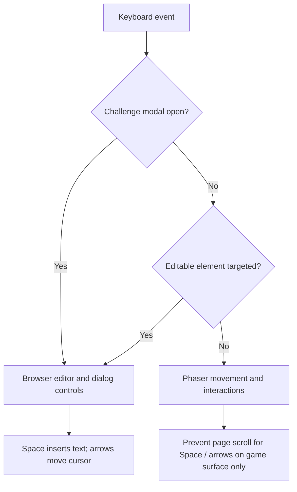

# CodeBreak — Keyboard input correction and release acceptance

**Release candidate:** v1.2.0-rc.2  
**Expected Git baseline:** `6a9c9e0` (`feature/release-acceptance-v1.2-20261027_101225`)  
**Purpose:** fix input routing, preserve stable gameplay, prepare controlled merge into `main`.

## Problem / root cause

Phaser's `KeyboardPlugin.addKeys()` defaults to capturing the registered keys by suppressing browser defaults. Because Phaser runs beside a real HTML `<textarea>`, it captured Space and arrow keys while players were editing code. This prevented normal whitespace insertion and caret movement.

## Correction

1. Register Phaser movement keys with `enableCapture=false`.
2. Reserve scrolling-related keys for gameplay only when no modal is open, the event originates from the page/game canvas, and the event is not targeted at an editable element.
3. Suppress scene movement input when a modal is open or the active element is editable.
4. Focus the programming `<textarea>` automatically when the challenge dialog opens.
5. Remove the document keyboard listener when Phaser scene shuts down or restarts.
6. Add automated keyboard routing regression tests and a standalone browser focus check.

No save-schema changes, floor curriculum changes, database migrations, or new runtime dependencies.

## Architecture / event routing

## Automated verification

`npm test` runs the keyboard-focused tests alongside the existing release suite. On the prepared source, **42 tests passed (42/42)**. Syntax checks passed. A Chromium DOM smoke check (without the Phaser runtime) confirmed that ArrowLeft moves the textarea caret and Space inserts a literal space. It did not execute the full Phaser/Vite game.

### Existing release evidence supplied by the Ubuntu user

- 38/38 base game tests passed before this patch.
- 6 capstone unit tests passed.
- 25 isolated PostgreSQL/API integration assertions passed.
- Production build and bundle-size gate passed.
- Git feature branch was pushed as `6a9c9e0`.

### Not yet verified for this patch

- Actual bundled Phaser/Vite runtime on Ubuntu (perform `npm run verify:release`).
- Space/arrow input while CodeBreak's Phaser scene is actively running.
- Firefox manual keyboard acceptance, accessibility checks, and final CI outcome.
- Public deployment and monitoring: not performed.

## Manual acceptance checklist — Firefox on Ubuntu

Before testing, export your save from **My Progress → Export**.

- [ ] Open a programming terminal. Editor automatically receives focus.
- [ ] Type `const message = "hello world";` — spaces appear immediately.
- [ ] Type several lines. Left/Right arrows move caret one character at a time.
- [ ] Up/Down arrows move caret between lines. Selection works with Shift+Arrow.
- [ ] Space inserts spaces in strings and code, without making Subject 404 jump.
- [ ] Ctrl+Enter still runs tests.
- [ ] Tab still inserts two spaces; Reset editor and Highlight toggle work.
- [ ] Close terminal. Move left/right, jump with Space, and interact with E.
- [ ] Solve a challenge; elevator doors open, Subject 404 boards, next floor loads.
- [ ] Repeat a test after switching floors and after refreshing the page.
- [ ] Verify save export/import and New Game still work.
- [ ] Check browser console for new errors.
- [ ] Confirm `.github/workflows/ci.yml` jobs passed on the new branch.

## Remaining release decisions

Treat v1.2.0-rc.2 as a **release candidate**, not a deployed production game. After local keyboard checks and CI pass, merge the branch to `main` and tag **v1.2.0** only if your acceptance policy is satisfied. A production launch additionally needs a hosting environment, HTTPS, domain, rate limits, logging, backups, and real-world accessibility/security evaluation.

The known Vite warning about a large lazy-loaded Phaser chunk is not a build failure; the size budget passed in the preceding release. The HTTP test script sometimes logs `API error unknown` for intentionally malformed JSON requests; improve diagnostic logging later, but don't expose request bodies or secrets.
