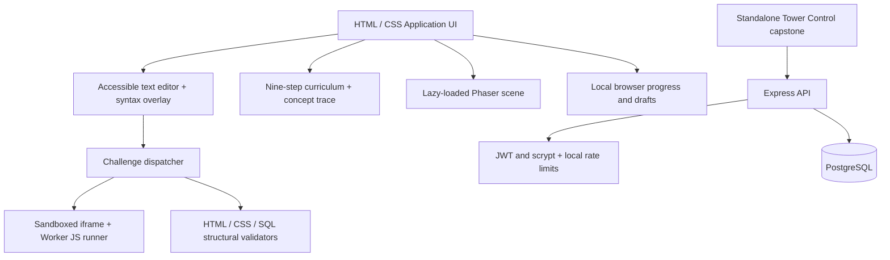
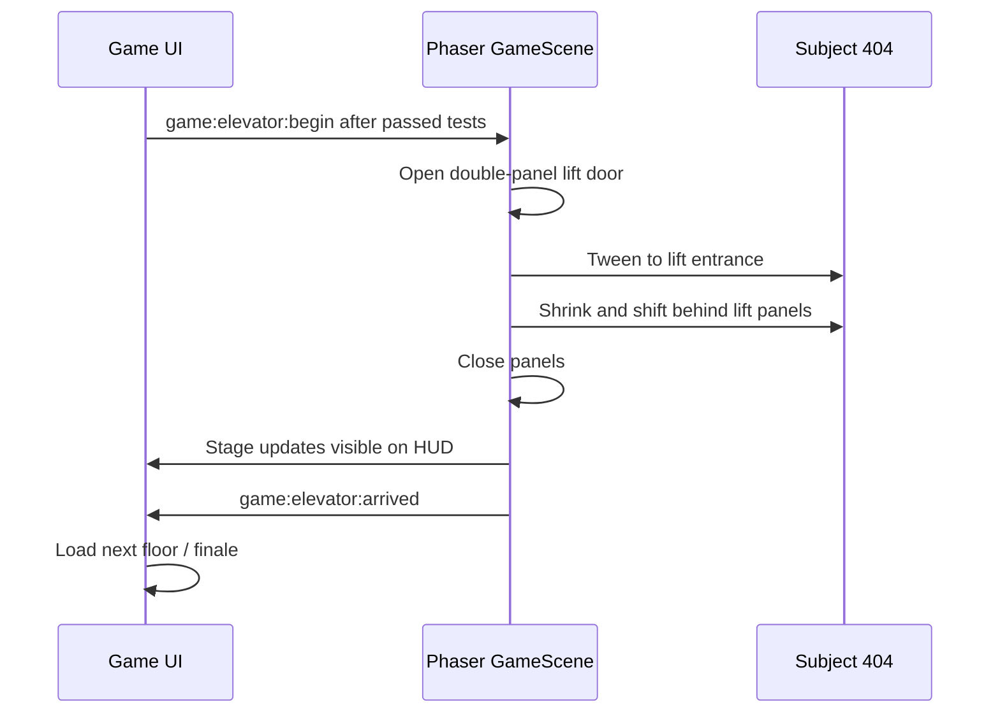

# CodeBreak v1.1.0-rc.1 — P0/P1/P2 implementation record

**Baseline:** `feature/full-tower-v1-rc1`, commit `3ce2cb3` (full tower + New Game hotfix).
**Status:** development release candidate; **NOT** a verified public production launch.
**Compatibility:** progress schema `codebreak:progress:v2` and `codebreak:draft:v1:<floor>` unchanged.

## Priority matrix

| Priority | Objective | Implementation | Acceptance evidence | Outstanding |
|---|---|---|---|---|
| P0 | Preserve known-good release | Source baseline ZIP + local pre-upgrade copy script | Baseline archive checksum; safe upgrade aborts on dirty Git tree | User must run script on their Ubuntu copy and export browser save |
| P0 | Commit and preserve New Game | Existing reset implementation retained | Reset regression tests pass | Confirm button visually in user's browser |
| P0 | Elevator transition clarity | Opening → walking → entering → doors closing → ascent, visible status changes | GameScene syntax and source-level checks | Manual Phaser visual/physics verification mandatory |
| P1 | Improve stickman movement | Landing pulse, dynamic head/arms/legs in jump/fall, foreground-to-background elevator layering | Source inspection and syntax check | Video-based subjective assessment on Ubuntu |
| P1 | Programming editor UX | Inert syntax highlighting, synchronized gutter/scroll, line+char metrics, off-switch, keyboard navigation | Node + Chromium smoke tests | Text selection, keyboard on mobile, long-code performance |
| P1 | Learning visualization | Accessible concept-trace stepper derived from lesson stage 4 | Browser smoke + unit tests | Educational efficacy with actual learners |
| P1 | Full-stack capstone | Existing Express/Postgres/JWT project retained | Source inspection; pure limiter tests | Install server dependencies and run DB integration acceptance locally |
| P2 | Load performance | Dynamic Phaser import; UI initializes before engine chunk | Module source check | Vite build chunk analysis; large Phaser chunk can remain |
| P2 | Security | Escaped code overlay, bounded local auth rate limit, no-store headers, DB readiness check | XSS smoke + limiter tests | External security review, JWT/API/live DB adversarial tests |
| P2 | Accessibility | Skip-to-main link, live elevator status, accessible textarea and trace controls, 44px touch targets | Browser smoke of components | Full WCAG/manual assistive-technology audit |
| P2 | Launch readiness | QA plan, rollout instructions, rollback and architecture diagram | Documented | TLS, observability, backups, CI/CD, real production environment |

## Component diagram

## Elevator state sequence

## Security boundary and limitations

1. JavaScript challenges run locally in an opaque-origin sandboxed iframe's Web Worker with time limits. They are **not** a safe place for secrets, nor a production multi-tenant code execution service.
2. HTML/CSS/SQL checks are structural learning feedback, **not** proof of all valid implementations. SQL statements are **not** actually run in PostgreSQL inside the game.
3. The stand-alone capstone uses real Node/Express/PostgreSQL and signed JWTs. It is **local development only**, not ready for Internet deployment. Its rate limiter uses bounded in-memory state; a distributed limiter and hardened proxy are required for production.
4. The browser's save JSON and LocalStorage remain writable by the player; progress is **not** a cryptographically verifiable credential or authoritative score.
5. Phases 10–15 were declared implementation deliverables; real-world deployment (Phase 15 acceptance) is **still pending**.

## Known limitations and next priorities

- Phaser may continue producing a >500 KB Vite chunk even with the new async loading boundary. That warning is not a build error.
- Rich code completion, AST-based security grading, collaborative editing and automated Postgres sandbox grading are future features.
- Test real elevator animation, collision, scrolling, modal focus, and touch UI on the user's Ubuntu browser.
- Server readiness endpoint `/api/ready` verifies DB reachability; `/api/health` verifies process only.
- Do not merge this feature branch into `main` until `npm run build`, tests, exploratory playthrough and capstone checks pass.
