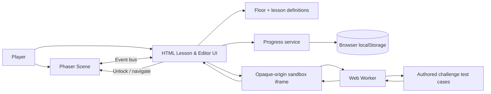
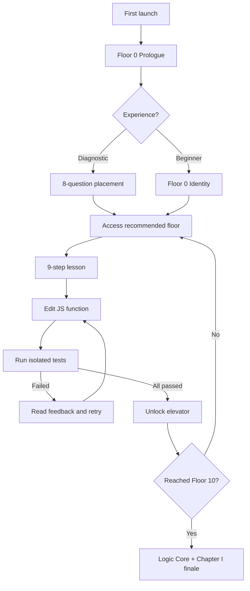

# CodeBreak — Phases 01–09 Implementation Report

**Version:** 0.2.0 / The Awakening
**Date:** 2026-10-26
**Milestone:** Stage III / First playable educational chapter

## Release scope versus complete game

The **complete product design** describes a 100-floor, ten-chapter full-stack JavaScript adventure. **This release is not that finished game.** It implements Chapters I's prologue, ten learning floors, the first boss, and a usable local game/learning experience. Phases 10–15 remain separate future development stages. Do not equate a green unit-test report with a production release audit.

## Implementation matrix

| Phase | Feature implemented in this release | Verification |
|---|---|---|
| 01 | Vite project, Phaser 3, Git-friendly source, scripts and docs | User already confirmed initial Phaser installation, Vite dev/build, Git push; new archive build needs local recheck |
| 02 | Original white stickman: idle, run, jump/fall poses, movement | Static source check; **physical Phaser browser playtest required** |
| 03 | Scrolling sector, platforms, camera follow, terminal and elevator | Source review; **physical browser playtest required** |
| 04 | Prologue, ROOT, PATCH, NULL references, narrative transitions | Headless UI flow passed |
| 05 | Authorable JS functions, isolated worker under opaque-origin iframe, multiple test cases, timeout, diagnostics | Browser valid/invalid/syntax error/infinite loop tests passed |
| 06 | Nine sections present across 11 authored floor lessons | Automated contract checks passed |
| 07 | localStorage versioned save/recovery, export/import, progress stats, diagnostic, replayable floors | Node state unit tests passed; browser UI partial integration passed |
| 08 | Floor 0 + ten concept floors, 11 challenges, final boss and finale | Headless browser interface completed all 11 challenge sets |
| 09 | Responsive panels, optional sound, mobile buttons, keyboard shortcuts, menus, reduced-motion support | Static inspection plus browser UI checks; full cross-device QA pending |

## System architecture (implemented)

## Floor progression

## Chapter I educational coverage

| Floor | Scene name | Applied skill | Required function |
|---:|---|---|---|
| 0 | Subject Not Found | Functions / identity cleanup | `identify` |
| 1 | The Dead Generator | Variables, numbers and comparison | `powerOn` |
| 2 | The Suspicious Door | Boolean logic | `checkAccess` |
| 3 | Signal Lost | Conditionals | `repairSignal` |
| 4 | Steps to Freedom | Loops | `countSteps` |
| 5 | Power Redistribution | Arrays / map | `doublePower` |
| 6 | Three-Door Protocol | Objects / find | `findSafeDoor` |
| 7 | Broken Transmission | String methods | `formatTransmission` |
| 8 | The Function Factory | Functions / defaults | `calculateEnergy` |
| 9 | Array of Broken Modules | Array filtering | `repairCore` |
| 10 | The Infinite Loop | Integrated loop logic / edge cases | `stabilizeLift` |

## Known implementation compromises

1. **Editor:** a multiline text editor with keyboard execution, not Monaco; this reduces Phase 5 weight and needs a later quality upgrade.
2. **Story scope:** narrative milestones through Chapter I only; the Architect's resolution and ROOT finale are Chapters II–X.
3. **Mastery:** passing authored examples is a useful learning check, not a plagiarism-proof or official credential evaluation. Tests are shipped client-side.
4. **Sandbox:** browser sandbox + worker provides local educational containment, but is not a complete production-grade attack-resistant executor. See README security discussion.
5. **Persistent capstone:** the Tower Control System is discussed throughout lessons, but real exported application source, backend and deployment are scheduled for future phases.
6. **Art:** minimalist procedural line-stickman, not an exact copy of the video asset.
7. **Performance:** no formal device matrix or production monitoring yet.

## Testing conducted in preparation

- Unit and contract tests with Node's `node:test`.
- Browser sandbox tests using headless Chromium, including one intentional infinite-loop timeout.
- UI integration test using headless Chromium and a mocked scene event bus that completed Floor 0 → Floor 10 and reached the finale.
- Source-level JavaScript syntax check (`node --check`).

**Not performed here:** `npm install` and real `npm run build` inside the authoring container because the npm registry was inaccessible, nor the live Phaser movement integration because Phaser's package was unavailable here. The recipient must run them locally. Do not treat the release as guaranteed defect-free.

## Phase 10 handoff

Once the player has tested the scene/controller on Ubuntu and all Phase I–III requirements are accepted, start **Phase 10 — Frontend Development Chapters** (HTML, CSS, DOM and asynchronous JS; Floors 11–50) in a separate feature branch. Keep the existing event bus, educational schema and progress migration versioned.
