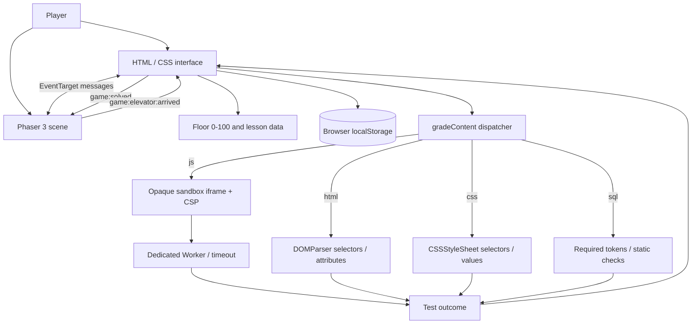
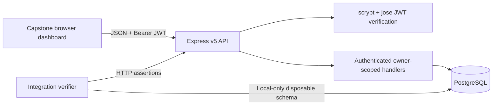
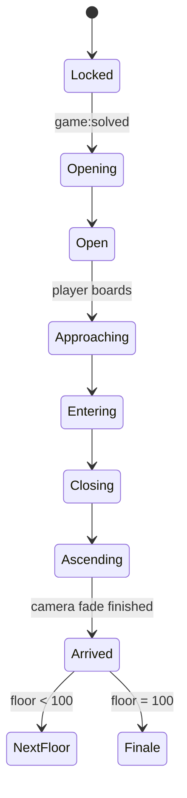
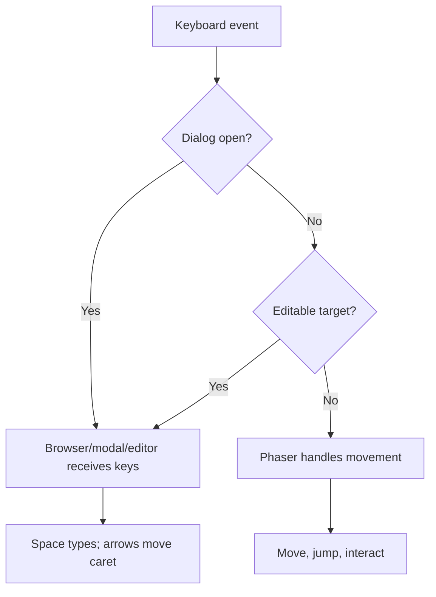
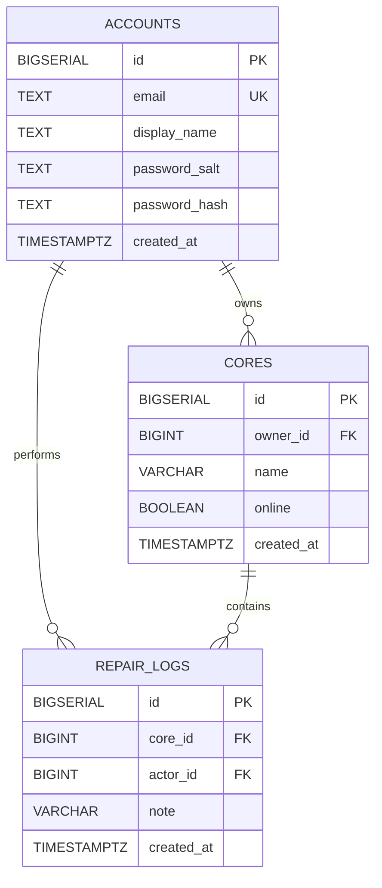

# CodeBreak: The Tower of Code — Developer & Maintainer Manual

> **Manual edition:** 1.0  
> **Source baseline:** tagged `v1.2.0-rc.2`, commit `82d13ba` on `main`  
> **App package:** `codebreak-tower-of-code@1.2.0-rc.2`  
> **Separate capstone package:** `tower-control-system-capstone@1.0.0`  
> **Audience:** Project owner, frontend/game engineers, curriculum authors, backend developers, QA, and future maintainers  
> **Last reviewed:** 27 October 2026

---

## Contents

1. [Project overview and accurate release status](#1-project-overview-and-accurate-release-status)
2. [Get the exact source](#2-get-the-exact-source)
3. [Development environment](#3-development-environment)
4. [Repository map and responsibilities](#4-repository-map-and-responsibilities)
5. [Architecture diagrams and trust boundaries](#5-architecture-diagrams-and-trust-boundaries)
6. [Runtime and lifecycle](#6-runtime-and-lifecycle)
7. [Data definitions and curriculum authoring](#7-data-definitions-and-curriculum-authoring)
8. [Game scene, player controller, and elevator](#8-game-scene-player-controller-and-elevator)
9. [Input routing and accessible editor](#9-input-routing-and-accessible-editor)
10. [Challenge validators and security model](#10-challenge-validators-and-security-model)
11. [Progress model and backward compatibility](#11-progress-model-and-backward-compatibility)
12. [Real Tower Control System capstone](#12-real-tower-control-system-capstone)
13. [Backend API specification](#13-backend-api-specification)
14. [Database design and migrations](#14-database-design-and-migrations)
15. [Testing and quality gates](#15-testing-and-quality-gates)
16. [CI/CD and Git workflow](#16-cicd-and-git-workflow)
17. [Performance and browser acceptance](#17-performance-and-browser-acceptance)
18. [Accessibility and instructional review](#18-accessibility-and-instructional-review)
19. [Threat model and known security limitations](#19-threat-model-and-known-security-limitations)
20. [Backups and rollback](#20-backups-and-rollback)
21. [Release, deployment, and operations](#21-release-deployment-and-operations)
22. [Troubleshooting playbook](#22-troubleshooting-playbook)
23. [Contributing and change-control procedures](#23-contributing-and-change-control-procedures)
24. [Technical debt and next releases](#24-technical-debt-and-next-releases)
25. [Verification matrix and sign-off](#25-verification-matrix-and-sign-off)

---

## 1. Project overview and accurate release status

**CodeBreak** is an original browser-based 2D platform adventure that teaches web development through Floor 0 and **100 numbered floors**. The game world is Phaser 3; supporting UI and lesson content use vanilla JavaScript, HTML, and CSS. The build uses Vite. A *separate* runnable capstone demonstrates a Node.js/Express/PostgreSQL/JWT application.

### The implemented release boundary

| Subsystem | In `v1.2.0-rc.2` | Boundary / limitations |
|---|---|---|
| Phaser game | Original stickman, movement/jump, doors, elevator sequence, chapters | Performance and browser-compatibility checks remain distinct. |
| Curriculum | 10 chapters, Floor 0 + 100 numbered floor records | Automated checks do not prove educational effectiveness. |
| UI | Story/dialogue, floor map, learner editor, modes, history, progress | No certified accessibility audit. |
| JS grader | Opaque-origin iframe + nested worker + time limit | Not designed as a hostile multi-tenant cloud judge. |
| HTML/CSS/SQL grading | Parser/structural checks | Not equivalent to full semantic, rendering, or live SQL execution. |
| Advanced backend lessons | Browser-modeled JavaScript tasks | No live Node/Express server per floor. |
| Standalone capstone | Express API, PostgreSQL, scrypt, JWT, dashboard, tests | Local demonstration; public deployment needs further security/operations work. |
| GitHub CI | Game build/tests and PostgreSQL-backed API tests | Maintainers must verify workflow runs per release; CI passing is not universal assurance. |
| Hosting | Local Vite game and loopback API | **No public production URL** is configured by this release. |

### Evidence supplied for this release

The maintainer reported that `npm run verify:release` passed **42 main tests** and built with Vite 8.3.5, that capstone unit tests passed **6/6**, and that the isolated database integration passed **25 HTTP/database assertions** using disposable PostgreSQL. The user confirmed the keyboard fix works and merged the tagged commit onto `main`. The main game's bundle-size gate passed. The Git tag `v1.2.0-rc.2` was pushed. GitHub Actions status, cross-browser testing, accessibility audit, complete beginner playtesting, and real public hosting are **not established by those logs**.

**Do not relabel this as a stable production release without an explicit release review.**

## 2. Get the exact source

```bash
# New developer machine
git clone https://github.com/derrenderrick00-ux/codebreak.git
cd codebreak
git fetch --tags
git checkout v1.2.0-rc.2
# Detached HEAD is expected for reproducible inspection.
```

To work on features, create a branch **from the tagged commit**:

```bash
git switch -c feature/update-manuals
```

On the original Ubuntu machine the working checkout is `~/Documents/codebreak`. Branch `main` was fast-forwarded to `82d13ba` and an annotated `v1.2.0-rc.2` tag was pushed. Verify rather than assuming:

```bash
git status
git log -1 --format='%h %d %s'
git tag --points-at HEAD
```

Example expected commit prefix: `82d13ba`. Other branches/tags may be added later.

## 3. Development environment

### Minimum declared tools

| Component | Requirement or observed baseline |
|---|---|
| Node.js | `>=20.19.0` declared in both package manifests; CI uses Node 22 |
| npm | Compatible version bundled with Node; use committed lockfiles and `npm ci` |
| Browser | Modern Firefox or Chromium; test both before release |
| Game deps | `phaser ^3.90.0` |
| Build deps | `vite ^8.3.5` |
| API deps | `express ^5.1.0`, `pg ^8.16.3`, `jose ^6.1.0`, `dotenv ^16.6.1` |
| DB | PostgreSQL; shipped Compose setup uses `postgres:17-alpine` |
| Docker | Optional for day-to-day gameplay; required for supplied disposable DB test script |
| Git | Required for version history, branching and releases |

### First-time setup

```bash
cd ~/Documents/codebreak  # or wherever you cloned the repo
node --version
npm --version
git --version
npm ci
npm test
npm run build
npm run dev
```

- Development URL: `http://127.0.0.1:5173/`, or the actual Vite output.
- Production preview: `npm run preview` after `npm run build` (check the printed address).
- Stop either server with `Ctrl+C`.
- Never run npm in `~/Downloads` unless you intentionally have a `package.json` there.
- `.env` files and credentials must stay out of Git.

The Vite dev server binds to **loopback** (`127.0.0.1`), not an external network interface.

## 4. Repository map and responsibilities

```text
codebreak/
├── .github/workflows/ci.yml        GitHub Actions release checks
├── index.html                      Semantic page shell and UI element IDs
├── package.json                    Main game scripts and dependencies
├── package-lock.json               Reproducible main dependency tree
├── public/favicon.svg              Branding
├── src/
│   ├── main.js                     AppUI first, lazy-import Phaser
│   ├── style.css                   Game/UI/editor styles
│   ├── core/bus.js                 EventTarget-based message bus
│   ├── core/sound.js               Optional sound
│   ├── game/GameScene.js           Phaser scene/physics/player/elevator
│   ├── game/keyboardFocus.js       Movement vs typing focus routing
│   ├── ui/app.js                   Modals, onboarding, challenges, progress
│   ├── ui/editor.js                Syntax display, gutters, metrics
│   ├── learning/lesson.js          The canonical nine learning steps
│   ├── learning/visualizer.js      Lightweight concept trace stepper
│   ├── content/floors.js           Floor 0–10 and unified FLOORS export
│   ├── content/extended.js         Chapters 2–10 / floor definitions
│   ├── content/diagnostic.js       Eight questions / placement algorithm
│   ├── runtime/sandbox.js          JS iframe + worker + timeout executor
│   ├── runtime/validators.js       HTML / CSS / SQL dispatchers
│   └── state/
│       ├── progress.js             Saved state schema and normalization
│       └── reset.js                Scoped New Game reset
├── tests/
│   ├── *.test.js                   Node's built-in test runner
│   └── browser/*.html              Browser-only validation harnesses
├── scripts/
│   ├── verify_release_gate.sh      Syntax/test/build/budget release gate
│   ├── check_bundle_budget.mjs     Asset-size limits
│   ├── verify_capstone_integration.sh Disposable DB test orchestrator
│   └── backup_and_install.sh       Historic safe upgrade helper
├── capstone/
│   ├── compose.dev.yml             Local persistent development DB
│   ├── compose.test.yml            Disposable verification DB
│   ├── client/                     Dashboard HTML/CSS/JS
│   └── server/
│       ├── .env.example
│       ├── package.json            Separate dependencies/scripts
│       ├── src/{app,server,db,migrate,security,limits}.js
│       ├── sql/001_initial.sql
│       ├── scripts/integration.mjs
│       └── tests/*.test.js
└── docs/                            Specifications, historical QA/release notes
```

Key principle: **curriculum content, game mechanics, validation, UI, persistence, and real backend are distinct concerns**. Do not put database credentials, server secrets or real authentication logic into the Phaser client.

## 5. Architecture diagrams and trust boundaries

### Main game (current implementation)



### Separate capstone (no automatic game-account integration)



**Trust boundaries:** Code entered in a floor is untrusted. LocalStorage is user-editable and not suitable for access control. The separate Express backend uses independently issued JWTs and checks record ownership at the database query level. No server should accept a client-side “floor mastered” field as an authorization credential.

## 6. Runtime and lifecycle

### Boot and navigation

1. `index.html` loads `src/main.js`.
2. `new AppUI()` loads and normalizes local progress, binds DOM actions, and listens to the event bus.
3. `import('./game/GameScene.js')` lazily loads Phaser, reducing the initial entry chunk.
4. Phaser creates `TowerScene`, actors, static platforms, keyboard mappings, terminal, and elevator.
5. The scene emits `game:ready`; AppUI displays introduction on first use or resumes the saved floor.
6. `gotoFloor()` updates progress, issues `game:floor`, and requests a scene restart with updated registry values.

### Interaction event contract

| Event | Producer → consumer | Payload example | Purpose |
|---|---|---|---|
| `game:ready` | GameScene → AppUI | `{floor}` | Scene ready; initialize UI/resume. |
| `game:near` | GameScene → AppUI | `{terminal,door}` | Show contextual interaction tip. |
| `ui:challenge` | GameScene → AppUI | `{floor}` | Open current lesson/editor. |
| `ui:locked` | GameScene → AppUI | `{floor}` | Explain why lift cannot open. |
| `game:solved` | AppUI → GameScene | `{floor}` | Open the elevator doors. |
| `game:lock` | AppUI → GameScene | `{locked}` | Freeze controls under modal. |
| `game:floor` | AppUI → GameScene | `{floor,solved}` | Restart scene at chosen floor. |
| `game:elevator:begin` | AppUI → GameScene | `{floor}` | Begin visual boarding sequence. |
| `game:elevator:stage` | GameScene → AppUI | `{stage,floor}` | Update transit status. |
| `game:elevator:arrived` | GameScene → AppUI | `{floor}` | Advance logical floor or show finale. |
| `game:control` | Touch buttons → GameScene | `{name,pressed}` | Virtual movement buttons. |

Read `src/core/bus.js` to keep emit/listen names stable. Scene listeners and document key listeners are **removed in the Phaser `shutdown` handler**; when adding listeners, clean them up to avoid accumulation after a floor restart.

## 7. Data definitions and curriculum authoring

### Content layout

- `src/content/floors.js`: authored beginner missions Floor 0–10; exports `FLOORS`, `FLOOR_COUNT=100`, and `getFloor()`.
- `src/content/extended.js`: `CHAPTERS` metadata and remaining floors. Chapter 2–10 generators/builders produce typed HTML, CSS, SQL, or JS challenges.
- `src/learning/lesson.js`: single canonical ordered list of nine steps.
- `src/content/diagnostic.js`: fixed eight-question placement bank and score thresholds.

### Floor data contract

A typical normalized floor has the following **conceptual** shape (not a TypeScript declaration):

```javascript
{
  floor: 12,             // unique integer; 0...100
  chapter: 2,           // 1...10
  title: 'Mission title',
  topic: 'Specific lesson concept',
  kind: 'html',          // 'html' | 'css' | 'sql'; omitted/default => JS
  fn: 'solveMission',    // required by JavaScript challenge executor
  setup: '...',         // editable starter program/markup/query
  tests: [/* authored test definitions; schema depends on kind */],
  lesson: {
    objectives: '...', terms: '...', explanation: '...',
    visualization: '...', example: '...', applications: '...',
    exercise: '...', miniProject: '...', capstone: '...', hint: '...'
  },
  dialogue: '...',
  success: '...'
}
```

**Do not copy the conceptual object verbatim as a complete JS mission:** JS test cases use `{args, expected, label}` and invoke the specifically named exported function. HTML tests use selectors and optional attributes/minimum counts; CSS tests require selector/property/value (and sometimes media conditions); SQL checks list required tokens/clauses.

### Adding a floor or changing one

1. Determine which chapter, skill outcome, and game-world problem it addresses.
2. Update the appropriate content file; keep `FLOORS` sorted and preserve **unique contiguous floor IDs**.
3. State one measurable objective and include nine nonempty lesson fields. Provide a helpful hint, real-world application and mini-project.
4. Write *multiple* tests, including boundary/negative cases. Ensure the starter solution intentionally requires a learner action.
5. For JS, provide a reference implementation and run it through authored cases in Node, then the actual browser harness.
6. For HTML/CSS/SQL, author browser-compatible structural checks and test at least one *different but valid* answer where possible; note when evaluation is narrower than the concept.
7. Confirm story dialogue remains coherent with the next floor and chapter core.
8. Run tests and smoke-play the changed floor, plus its predecessor/successor.
9. Update the manuals/changelog and QA evidence if controls, outcomes, storage or risk boundaries change.

**Important scalability caveat:** floor count, chapter boundaries, core awards, UI labels, reset iterations and tests assume **100 numbered floors**. Do not add Floor 101 casually; plan a schema/content version change and explicit migration before changing these invariants.

### Study-method rubric

For each floor, review: objectives → definitions → reasoning → visual model → runnable example → real-world usage → exercise → mini-project → capstone connection. The same outcome should be reinforced in task wording, submitted code, grader feedback and elevator-state change.

## 8. Game scene, player controller, and elevator

`GameScene.js` defines `TowerScene`, with:

- Arcade physics gravity, world bounds, static platform colliders, and a transparent physics hitbox for Subject 404.
- Original procedurally drawn head/limbs, changing postures and lightweight landing feedback.
- A camera following the character and a sector-specific background.
- One interactive coding terminal and an ascent lift per floor.
- Keyboard and virtual-touch movement, scripted elevator boarding, and chapter/core story transitions.

**Current scene constants** (do not silently change without playtesting): scene world `1180×540`, Phaser render view `960×540`; walking speed `215`, sprint `285`, jump impulse `410`, gravity `1030`; terminal approximately `x=750`, lift approximately `x=1080`. The world may scale to fit screen size.

### Elevator state machine



The **scene** owns the physical transit animation and emits arrival. The **UI** owns logical progression and decides whether to show next-floor story or finale. This separation prevents instant teleporting before boarding. `transitioning` / `elevatorInProgress` guards prevent duplicate transitions. The scene contains a guarded delayed callback fallback if the camera fade event is missed.

### Manual regression sequence for elevator edits

- Fail a mission: lift stays locked.
- Pass: panels slide open and indicator changes.
- Board with `E`: walking animation, approach, enter, scale/depth shift, door close, fade, arrival.
- Board with modal button: same behavior.
- Attempt double-click/rapid `E`: exactly one transition.
- Revisit a cleared floor: door is open; no unearned new progression.
- Floor 10 → 11 and Floor 100 finale work.

## 9. Input routing and accessible editor

**Keyboard regression `v1.2.0-rc.2`:** Phaser was capturing Space and arrow-key defaults globally, breaking textarea editing. The corrected design:

1. Registers Phaser keyboard keys with capture suppression turned **off**.
2. Uses `src/game/keyboardFocus.js` to determine whether input belongs to the game canvas/body or an editable field/dialog.
3. Disables game controls while a modal is open.
4. Automatically focuses `<textarea id="code-input">` when a challenge appears.
5. Only prevents page scrolling for game movement keys on the game surface and in the absence of modifiers.
6. Disposes global listeners on scene shutdown.

### Focus routing diagram



`src/ui/editor.js` preserves an accessible textarea, adding an **escaped nonexecuting syntax-display layer**, line-number gutter, cursor/character metrics and optional highlighting. `src/learning/visualizer.js` renders a compact, accessible arrow-path/punctuation concept stepper; **it does not execute or trace arbitrary code**.

Test `Ctrl+Enter`, Space in strings, multiline Up/Down, Shift+arrow selection, Tab indentation, Esc closure, focus restoration, keyboard-only navigation, and screen-reader announcements whenever modifying the editor.

## 10. Challenge validators and security model

### Dispatch

`gradeContent(source, floor, runChallenge)` chooses validator by `floor.kind`:

```text
             gradeContent
                  |
          +-------+--------+----------+
          |       |        |          |
         JS      HTML     CSS        SQL
          |       |        |          |
   iframe/worker DOMParser CSSOM   Token matching
          |
  results / timeout
```

### JavaScript executor

- `src/runtime/sandbox.js` builds an `iframe` with `sandbox="allow-scripts"` but **without** `allow-same-origin`.
- A restrictive CSP disables network connections and many resource types, while permitting the inline script and blob worker needed by this implementation.
- A nested dedicated worker receives `source`, expected function name, and authored test cases.
- Worker compiles learner code with `new Function` **inside the restricted worker**; it is never invoked in the trusted main app page.
- Default execution deadline is **2,400 ms**; on result/timeout the iframe is removed.
- Parent verifies `postMessage` source, opaque `'null'` origin, and nonce/token for a matching response.
- JS lesson input size is limited to 12,000 characters.

**Risk:** This defense-in-depth arrangement is appropriate to the current local learning game, but not proof of resistance to determined malicious or adversarial students. Do not treat it as a production multi-tenant remote code execution service. Never remove isolation for convenience.

### Structural validators

- **HTML:** `DOMParser` examines required selectors, minimum element counts, and attribute presence; user markup is previewed in a non-scriptable restricted iframe.
- **CSS:** `CSSStyleSheet` parses declarations and media rules, canonicalizes values for comparison; external `@import` and `url()` are rejected. Preview is restricted.
- **SQL:** checks required clauses/tokens after whitespace/comment normalization; **no real execution**. This checker may accept semantically incorrect SQL that happens to contain the required tokens.

### Keep graders honest

Build malicious/edge-case tests, but **do not describe these structural checks as equivalent to a real SQL database, HTML accessibility certification, or server security assessment**. Keep public learner-facing explanations explicit about simulation boundaries.

## 11. Progress model and backward compatibility

`src/state/progress.js` stores state under **`codebreak:progress:v2`** and uses a schema version integer `2`, despite application releases 1.x. The version relates to the **save format**, not the application tag.

### Current schema excerpt

```json
{
  "version": 2,
  "currentFloor": 0,
  "unlockedFloor": 0,
  "completed": [],
  "attempts": {},
  "mastered": {},
  "mode": "guided",
  "onboarding": false,
  "diagnostic": null,
  "sound": false,
  "playedIntro": false,
  "chapterCompleted": false,
  "gameCompleted": false,
  "updatedAt": "<ISO timestamp>"
}
```

Additional draft keys: `codebreak:draft:v1:0` … `codebreak:draft:v1:100`. A malformed main save may be copied to `codebreak:corrupt:last` and replaced with a fresh record. `normalizeProgress` rejects unsupported schema versions, bounds floor indices, strips invalid attempts/mastery fields, and recomputes the chapter/game completion flags from passed floors.

### Important invariants

- Floor 0 is a playable prologue but not counted in the `cleared / 100` metric.
- A diagnostic unlocks access through a recommended floor but never adds `completed` or `mastered` entries.
- Clearing a floor unlocks its successor, and passing a chapter ending awards the corresponding core.
- “mastered” currently means **all authored floor tests passed**. It does not prove independent mastery in the classroom or workplace.
- Draft edits are separate from progress export. JSON export includes the progress record only.
- LocalStorage can fail in private browsing or with disabled storage; save attempts fail gracefully but may not persist.

### Storage change policy

Before changing schema: define a **new version and migration**, add old-save fixtures, test import/replay/reset, preserve a rollback path, and document the impact. Do not use `localStorage.clear()`, which would delete unrelated origin data. New Game intentionally removes CodeBreak-owned drafts and replaces only the CodeBreak progress record.

## 12. Real Tower Control System capstone

This is independent of the main browser game. The game does **not** automatically synchronize accounts or passes with the capstone. It is an actual Express + PostgreSQL application run locally.

### Start local PostgreSQL (development)

From repository root:

```bash
docker compose -f capstone/compose.dev.yml up -d
docker compose -f capstone/compose.dev.yml ps
```

The development Compose file binds PostgreSQL on **`127.0.0.1:5432`** and uses a **persistent volume** named `codebreak_postgres`. If 5432 is occupied, stop/conflict-resolve carefully or choose a different host port **and update your `DATABASE_URL`**. Do not delete volumes to solve a port conflict.

### Configure and start server

```bash
cd ~/Documents/codebreak/capstone/server
cp .env.example .env
openssl rand -hex 32         # Generate a new random JWT secret; do not commit it
# Open .env and replace JWT_SECRET with the generated secret;
# confirm DATABASE_URL, ALLOWED_ORIGIN, and PORT match your environment.
npm ci
npm run migrate
npm test
npm run dev
```

Open **`http://127.0.0.1:4500/`**. Test: register, login, view your cores, create a core, delete it, logout. The server binds to **`127.0.0.1`** intentionally. The example database credentials are strictly for localhost development; never reuse them outside your laptop.

### Expected server responses

```bash
curl -i http://127.0.0.1:4500/api/health
# HTTP/1.1 200 OK; JSON {"status":"ok"}

curl -i http://127.0.0.1:4500/api/ready
# 200 and {"status":"ready"} if database connection works;
# 503 and {"error":"Database unavailable"} if it does not.
```

### Shut down safely

- Server terminal: `Ctrl+C`.
- Development PostgreSQL container: `docker compose -f capstone/compose.dev.yml stop` from repository root.
- `docker compose ... down` removes the container/network **but not** its named volume by default.
- **Never add `--volumes`/`-v` when you want to preserve your development database.**

## 13. Backend API specification

Implemented in `capstone/server/src/app.js`, with `makeApp({db,secret,issuer,audience,allowedOrigin})`. Unauthenticated health/readiness routes coexist with authenticated owner-scoped `/api` endpoints.

| Method | Endpoint | Authentication | Request / expected behavior |
|---|---|---|---|
| `GET` | `/api/health` | No | Basic app health: `{status:"ok"}`. |
| `GET` | `/api/ready` | No | Tests `SELECT 1` against database; 200 or 503. |
| `POST` | `/api/register` | No | `{email,displayName,password}`. Password length 12–256. Creates account, 201; duplicate 409. |
| `POST` | `/api/login` | No | `{email,password}`. Returns `{accessToken,user}` on success; bad credentials 401. |
| `GET` | `/api/me` | Bearer JWT | Returns current account identity. |
| `GET` | `/api/cores` | Bearer JWT | Lists only current account's cores. |
| `POST` | `/api/cores` | Bearer JWT | `{name,online}` creates current user's core; 201. |
| `PATCH` | `/api/cores/:id` | Bearer JWT | `{name,online}` updates **owned** core; 404 for non-owned/not found. |
| `DELETE` | `/api/cores/:id` | Bearer JWT | Deletes **owned** core; 204 on success. |

### Authentication details

- Password hashing: random 16-byte salt, Node `scrypt`, timing-safe comparison.
- JWT: `jose`, **HS256**, issuer and audience checks, subject account ID, **30-minute** expiration.
- Dashboard stores the access token **in JavaScript memory**, not in localStorage; logout clears the in-memory reference. Refreshing the page requires logging in again.
- Authorization: authenticated owner ID comes from the validated token and is included in DB queries (`owner_id = $n`), not taken from client-submitted `owner_id`.
- Auth endpoints use bounded **in-process** per-IP rate limiting in development; this is not suitable for shared/distributed production traffic.
- Request JSON body limit: **16 KB**. The app sets basic security headers and rejects unexpected Origin values.

### Example calls (development account only)

```bash
# Registration: substitute your own local test account credentials.
curl -i http://127.0.0.1:4500/api/register \
  -H 'Content-Type: application/json' \
  --data '{"email":"testuser@example.invalid","displayName":"Test Dev","password":"LOCAL-TEST-PASS-123"}'

# Login (response includes a JWT). Avoid pasting the token into public logs.
curl -i http://127.0.0.1:4500/api/login \
  -H 'Content-Type: application/json' \
  --data '{"email":"testuser@example.invalid","password":"LOCAL-TEST-PASS-123"}'

# Copy the returned accessToken into a terminal variable locally:
# read -rs TOKEN
# curl -H "Authorization: Bearer $TOKEN" http://127.0.0.1:4500/api/me
```

For machine-to-machine integration, add proper token handling, error-state tests, and avoid echoing secrets. The capstone does not provide refresh-token issuance or revocation.

## 14. Database design and migrations

### Actual initial schema

`capstone/server/sql/001_initial.sql` creates three tables:

- `accounts`: `id` (bigserial PK), unique email, display name, password salt/hash, creation time.
- `cores`: `id` (PK), `owner_id` referencing `accounts(id)` with cascade delete; core name, Boolean online flag, creation time.
- `repair_logs`: `id` (PK), `core_id`, `actor_id`, note, creation time. This table exists in the schema; the current API does not expose dedicated repair-log routes.

There is a `cores_owner_idx` index on `cores.owner_id`.



The current `npm run migrate` reads and executes `001_initial.sql`; it is a simple script using `IF NOT EXISTS`, **not** a full versioned migration manager with rollback tracking. For production, introduce versioned migrations, schema drift checks, backward-compatible deployment sequencing, and restore rehearsals.

### Rules for SQL changes

1. Back up development data first.
2. Use parameterized queries (`$1`, `$2`, ...) for user-controlled values; never interpolate values into SQL text.
3. Enforce ownership at query level for every new private resource.
4. Add foreign keys, indexes, validation and constraints where appropriate.
5. Add migration + integration tests, including cross-user access attempts.
6. Plan how old installations upgrade and how rollbacks behave.

## 15. Testing and quality gates

### Main game checks

From the repository root:

```bash
npm test
npm run build
npm run test:bundle
npm run verify:release
```

- `npm test`: Node's built-in test runner over `tests/*.test.js`.
- `npm run build`: Vite optimized bundle and syntax/import verification.
- `npm run test:bundle`: asset size budget (requires existing `dist`).
- `npm run verify:release`: static syntax checks → main tests → production build → bundle budget → optional capstone unit tests → **database integration only if `CODEBREAK_TEST_DATABASE_URL` is explicitly provided**.

**Do not interpret `PENDING` from `verify:release` as a DB failure or success.** The database integration is a separate opt-in gate and was run successfully by the maintainer using the Docker wrapper.

### Current bundle-size budgets (`scripts/check_bundle_budget.mjs`)

| Asset | Limit |
|---|---:|
| Initial JS (uncompressed) | 180,000 bytes |
| Initial JS (gzip) | 75,000 bytes |
| All JS chunks combined | 1,600,000 bytes |
| CSS | 150,000 bytes |

The large **lazy-loaded Phaser chunk** can trigger Vite's generic >500 KB advisory despite passing the project's own budgets. It is still worth benchmarking startup and FPS: byte budgets are **not performance benchmarks**.

### Capstone unit tests

```bash
npm ci --prefix capstone/server
npm test --prefix capstone/server
```

### Real, isolated PostgreSQL/API integration

From the repo root:

```bash
bash scripts/verify_capstone_integration.sh
```

Requirements: Docker Engine and Docker Compose v2. The wrapper:

1. Starts `postgres:17-alpine` in a **disposable** Compose project.
2. Binds it to `127.0.0.1:55432` by default (override `CODEBREAK_PG_TEST_PORT`).
3. Installs capstone dependencies, runs unit tests, and executes `capstone/server/scripts/integration.mjs`.
4. Creates a unique isolated SQL schema, applies the schema, starts a real local Express listener, and exercises HTTP requests.
5. Tests registration, duplicate rejection, wrong password, JWT tampering, authorization, cross-account isolation, validation, malformed/oversize JSON, CRUD persistence, and readiness.
6. Tears down the disposable project and removes its test data with `docker compose ... down --volumes`.

**Do not** point this verifier at an important non-test database. Its integration runner creates/drops schemas. The supplied wrapper uses a throwaway test instance.

The maintainer reported **25 passing live HTTP/database assertions** and **6 passing capstone unit tests** in the tagged release preparation. Test again after backend modifications.

### Browser harnesses and acceptance

- `/tests/browser/extended.html`: HTML/CSS/SQL and JS exercise checks inside a browser context.
- `/tests/browser/keyboard-focus.html`: focus/textarea keyboard smoke check.
- `/tests/browser/editor-refinement.html`: syntax layer/editor behavior.

Serve these from Vite, e.g. `http://127.0.0.1:5173/tests/browser/extended.html`. The browser harnesses supplement—not replace—manual gameplay, keyboard, accessibility and performance tests.

## 16. CI/CD and Git workflow

### Current GitHub Actions workflow

`.github/workflows/ci.yml` runs for pushes to `main` and `feature/**`, plus PRs targeting `main`:

1. **game** job — Node 22, `npm ci`, then `npm run verify:release`.
2. **capstone** job — Node 22, PostgreSQL 17 service, capstone dependency install, capstone unit tests and live DB integration tests.

The workflow currently handles **continuous integration**; it does **not** automatically deploy the product. Verify the job status for the particular commit in GitHub before marking release acceptance complete.

### Branch policy

- `main`: accepted source baseline.
- `feature/<topic>`: one independently reviewable change.
- `fix/<topic>`: corrective patch.
- Use PRs, diff review, and CI gates before merging.

A tested feature branch should be merged cleanly, preferably by a reviewable PR. For an agreed fast-forward-only workflow:

```bash
git status              # must be clean
git switch main
git pull --ff-only origin main
git merge --ff-only feature/update-manuals
git push origin main
```

If fast-forward fails, **do not force**; investigate divergence and use the appropriate review/rebase/merge process.

### Tags and version discipline

The existing tag is **`v1.2.0-rc.2`**, matching package version `1.2.0-rc.2`. Keep release candidates and stable releases distinct.

For a future stable release, change the package version and lockfile first, test, commit, then tag the **accepted commit**:

```bash
# Example only, execute after complete acceptance and changelog review:
npm version 1.2.0 --no-git-tag-version
npm run verify:release
git add package.json package-lock.json
git commit -m "chore(release): mark CodeBreak v1.2.0 stable"
git tag -a v1.2.0 -m "CodeBreak v1.2.0 stable source release"
git push origin main
git push origin v1.2.0
```

The stable tag is **not justified solely by a green local build**; follow the [verification matrix](#25-verification-matrix-and-sign-off).

## 17. Performance and browser acceptance

### Verify under realistic conditions

- Firefox and Chromium on Ubuntu; test at least one mobile/narrow viewport.
- Cold start with cache cleared; repeat start with warm cache.
- Inspect FPS stability during walking, jumping, door tween, and camera fade.
- Confirm no significant memory increase after 30+ floor changes (look for leaked listeners/tweens).
- Check load and editor responsiveness on a laptop with **8 GB RAM** (relevant hardware baseline for this project).
- Evaluate touch buttons, orientation changes, modal scrolling and focus.
- Use the browser Network/Performance/Memory panels for **measured values**, not guesses.

Keep reporting honest: record browser version, viewport, cold/warm cache, FPS measurement tool, timings, memory estimates, and whether Vite ran in dev or preview mode. Prefer testing optimized output with `npm run build && npm run preview` as well as the dev server.

### Performance architecture

The app constructor loads UI/lessons first; Phaser is imported asynchronously. In the verified Vite build reported by the maintainer, the initial JS was about **102 KB** and the lazy-loaded `GameScene` chunk about **1.2 MB** uncompressed. Do not assume the latter is transferred in full on every visit; caching and compression affect network behavior. Benchmark instead of merely suppressing warnings.

## 18. Accessibility and instructional review

### Accessibility checks

- Keyboard navigation of menus, buttons, dialogs, mode selector, lesson panels, and floor map.
- Escape closes dialogs; Tab cycles within a dialog; focus returns to the prior interactive control.
- Space and arrows behave normally in textareas, inputs and forms.
- Screen-reader labels/status messages are meaningful; `aria-live` regions are not excessively noisy.
- Focus indicators, text contrast, zoom to 200%, reduced-motion expectations, responsive layout and touch targets.
- Avoid relying only on colors (“red failed, green passed”)—use text labels too.
- Verify lesson reading order and code editor in assistive technologies; the game canvas itself is not a substitute for an accessible alternative interaction path.

**Accessibility remains to be formally audited** against the target standard before public marketing claims.

### Educational effectiveness checks

- Beginner without prior programming can understand the objective from the game alone.
- Each failure is specific enough to guide reasoning without exposing an answer by default.
- Content coverage and tests match the stated lesson concept.
- The three modes change scaffolding rather than silently changing correctness.
- Avoid reward inflation: passing authored tests is a floor result, not accredited professional mastery.
- Independent capstone assignment is assessed separately from the simulated backend exercises.
- Test with multiple new learners and record misunderstandings, abandonments and time-to-solve.

## 19. Threat model and known security limitations

### Assets and attackers

- Assets: local game saves/drafts, player browser, game origin, developer machine, demo account data, JWT signing secret, PostgreSQL credentials and records.
- Potential threats: hostile user-submitted code, malicious imported save JSON, XSS through learner code displays, untrusted web origins, password guessing, stolen tokens, broken record ownership, leaked secrets, oversized requests, abusive resource consumption and unsafe database cleanup.

### Implemented mitigations (not an audit certificate)

| Risk | Existing protection | Remaining issue |
|---|---|---|
| JS submission runs arbitrary code | Sandboxed opaque-origin iframe, worker, CSP, 2.4s timeout | Formal hostile-code sandbox audit, CPU/memory quotas for remote service. |
| HTML/CSS preview executes scripts | Restricted preview iframe/CSP | Additional browser and policy testing; evaluator bypasses possible. |
| XSS from displayed source | Escape code before syntax presentation | Continue reviewing all future dynamic HTML/DOM sinks. |
| SQL injection in capstone | Parameterized `pg` queries | Review all new routes and migration scripts. |
| Account password exposure | scrypt salted hashing | Harden logging/secret rotation; credential reset flow not implemented. |
| JWT forgery/expiry | HS256 verification, issuer, audience, subject and expiry checks | Revocation, rotation and refresh strategy absent. |
| Cross-account access | Query-level owner scoping and 25 reported integration assertions | Re-test after any new resource endpoint. |
| Login brute-force | Bounded in-process per-IP limiter | Distributed, proxy-aware rate limiting needed for public traffic. |
| Excess request body | 16 KB Express JSON limit | Production WAF/traffic and monitoring considerations. |
| Untrusted browser save | Normalization and bounds; save is non-authoritative | Users can still edit their own floor progress; don't make it a credential. |
| Secrets in Git | `.env` excluded by gitignore | Secret scanning, review, rotation and secure deployment storage needed. |

**Explicit limitation:** The source contains a local demonstration app. It has **not** undergone penetration testing, privacy impact assessment, or production threat-model sign-off. Do not deploy the capstone to public endpoints unchanged. Rate limiting, TLS/reverse proxy, backups, monitoring, logging, token lifecycle, and incident response need a separate implementation plan.

## 20. Backups and rollback

**There are two independent data stores to protect:**

1. **Project source and Git history:** repository directory including `.git`.
2. **Player/browser data:** exported localStorage progress JSON and important draft source copied separately.

### Before any upgrade

```bash
cd ~/Documents/codebreak
git status  # require clean tree; commit or preserve intentional modifications first
cd ~/Documents
cp -a codebreak "codebreak-backup-$(date +%Y%m%d_%H%M%S)"
```

In the UI, choose **My progress → Export save (JSON)**. The user previously generated filesystem backups named `codebreak-backup-before-v1.1-...` and `codebreak-backup-before-v1.2-...`; use new unique names for further work.

### Safe Git-based rollback when the new version has not been accepted

```bash
cd ~/Documents/codebreak
git status                     # record/stash/commit any work first
git switch -c recovery/<issue> # optional branch from current state
# For a separate comparison checkout without overwriting the live folder:
git worktree add ../codebreak-known-good v1.2.0-rc.2
```

### Filesystem restoration (use only when necessary)

Stop the Vite server, locate the actual backup, and **move the current folder aside rather than deleting it**:

```bash
mv "$HOME/Documents/codebreak" "$HOME/Documents/codebreak-failed-$(date +%Y%m%d_%H%M%S)"
cp -a "<verified-backup-path>" "$HOME/Documents/codebreak"
```

Replace the placeholder with the real backup path. Import the JSON save separately in the browser if needed. This operation does **not** restore browser data by copying project files.

### PostgreSQL backups

The dev Compose named volume persists between normal stop/start. Before database migrations, dump data with `pg_dump` to a secure location, confirm the dump file, and rehearse restoration to a separate test database. **Never `docker compose down -v` on the persistent dev environment unless deliberate deletion is intended.** The supplied disposable `compose.test.yml` is different and is intentionally destroyed after tests.

## 21. Release, deployment, and operations

### What was finalized vs not finalized

The **source** is committed to `main` and tagged `v1.2.0-rc.2`. That is a reproducible **release-candidate tag**, not evidence of production hosting. `npm run dev` and `npm run preview` bind locally; the capstone API binds to loopback. A stable public launch still needs explicit hosting and deployment approval.

### Release checklist (source)

- [ ] Working tree clean; desired branch/commit/tag recorded.
- [ ] Main game tests/build/bundle budget pass on supported Node versions.
- [ ] Capstone unit and real disposable DB integration tests pass.
- [ ] CI jobs green for *exact* release commit.
- [ ] Manual game, keyboard, visual and browser regression tests pass.
- [ ] No high-severity defects remain open.
- [ ] Documentation reflects known limitations; versions/tags match.
- [ ] Security and privacy sign-off recorded for intended audience.

### If planning public game hosting

1. Pick a static host supporting proper MIME types, HTTPS and SPA/static asset routing for Vite output.
2. Build a release artifact via `npm ci && npm run build`; deploy `dist/` (not `node_modules/`, `.git/`, `.env`).
3. Configure Content Security Policy deliberately, balancing the current sandbox-worker design and host restrictions; test it across browsers. Do **not** arbitrarily tighten/remove the worker/blob permissions without running the challenge suite.
4. Set HTTP security headers and cache immutable assets appropriately; never cache sensitive API responses.
5. Set up domain/TLS, uptime/performance monitoring, error reporting and rollback strategy.
6. Decide explicitly whether accounts/cloud progress are in scope. **Current game progress is local only.**
7. Do not publicly expose the capstone API until its additional security/ops blockers are addressed.
8. Write an incident response and backup/restore runbook, then rehearse them.

The current GitHub Actions workflow runs checks only—**it does not publish to production**.

## 22. Troubleshooting playbook

| Failure | Diagnose | Corrective action |
|---|---|---|
| `ENOENT ... package.json` | `pwd; ls -la` | `cd ~/Documents/codebreak`; rerun npm command. |
| `npm ci` fails | Node version, lockfile, permissions/network | Verify Node >=20.19, use clean checkout, inspect error; don't blindly delete lockfile. |
| Vite cannot start | Port in use / wrong working dir | Check printed error; stop old process or deliberately change port. |
| Build >500 KB warning | Large lazy Phaser chunk | Compare `npm run test:bundle` limits; benchmark actual loading. |
| Editor Space/arrow bug | Old build, global Phaser capture or focus | Check `keyboardFocus.js`, `addKeys(..., false)`, modal focus, `tests/keyboard-focus.test.js`. |
| Elevator opens but cannot board | UI event / scene state / callback race | Inspect `game:elevator:begin` → stages → `game:elevator:arrived`; test floor transition lock. |
| Floor progress doesn't save | localStorage disabled/full, unsupported schema | Inspect browser storage and `progress.js`; export before changes. |
| SQL accepted but incorrect | Structural validator limitation | Execute query in disposable Postgres, tighten specific tests and lesson note. |
| `docker: command not found` | Docker Engine missing | Install/configure Docker or use dedicated localhost test DB per docs. |
| Port `5432` or `55432` busy | DB service port collision | Check `ss -ltnp`; choose separate test port; protect existing volume. |
| `/api/ready` returns 503 | DB unavailable or bad DATABASE_URL | Verify Compose status, URL credentials, migration and server logs. |
| 401 on API endpoint | No JWT / expired / invalid issuer/audience | Log in again; avoid leaking tokens in logs. |
| 403 Origin not allowed | Browser request Origin mismatched `ALLOWED_ORIGIN` | Set correct local origin, don't disable origin enforcement. |
| 409 on registration | Account already exists | Use a separate test email or log in. |
| 429 on auth route | Local limiter reached | Wait for retry window; verify tests aren't unintentionally sharing state. |
| JSON body 413 | >16 KB request | Reduce request to valid bounds; don't enlarge limit without risk review. |
| Integration logs `API error unknown` | Intentionally malformed/oversize JSON tests | Check assertions; improve sanitized logs, not expose raw bodies. |
| CI red while local green | Different environment, DB service readiness, lockfiles | Inspect exact failing CI job/log, reproduce using `npm ci` and disposable DB. |

### Basic diagnostics

```bash
pwd
node --version
npm --version
git status --short
npm test
npm run build
npm run test:bundle
# For DB acceptance:
docker compose version
bash scripts/verify_capstone_integration.sh
```

When filing a bug include **version/tag/commit, browser, OS, reproduction steps, expected/actual result, console excerpt, relevant floor, screenshot, and whether browser storage was reset**. Scrub secrets and identifying personal data.

## 23. Contributing and change-control procedures

### Definition of done for each change

- [ ] Requirement and expected user behavior recorded.
- [ ] A focused branch exists; baseline preserved.
- [ ] Implementation is separated by subsystem.
- [ ] Unit tests cover normal, boundary and failure cases.
- [ ] Browser/manual reproduction passes where visual behavior is involved.
- [ ] Security/isolation impact assessed for code execution, storage, API or database edits.
- [ ] Backward compatibility, migrations, and rollback considered.
- [ ] Docs, changelog and examples updated.
- [ ] CI is green and reviewer approval obtained.
- [ ] Git commit names scope and purpose; no secrets/debug dumps in diff.

### Suggested commit prefixes

- `feat:` new player-facing feature
- `fix:` bug correction
- `test:` regression/acceptance coverage
- `docs:` documentation only
- `refactor:` structural change without intended behavior change
- `perf:` measured optimization
- `chore(release):` version/packaging changes

### Issue template (copy into GitHub)

```markdown
**Version/tag/commit:**
**Environment:** Ubuntu / browser / Node version
**Floor or subsystem:**
**Steps to reproduce:**
1.
2.
3.
**Expected behavior:**
**Actual behavior:**
**Console/terminal output (sanitized):**
**Regression test added?** [ ] yes [ ] no
**Impact:** [ ] blocker [ ] major [ ] minor [ ] improvement
```

### Documentation management

Treat the current tag as the **documented baseline**. For future versions: edit manual edition and scope line; add a release note; reference the exact branch/tag; do not rewrite historical QA as though later work existed at the time.

## 24. Technical debt and next releases

| Priority | Candidate improvement | Acceptance evidence needed |
|---|---|---|
| Critical for public launch | Production threat model, secret handling, TLS, distributed limiter, monitoring and backups | Security review, staging test, restore drill |
| High | Dedicated learner study with complete beginner and independent capstone outcomes | Structured user tests / observed learning gains |
| High | Cross-browser, accessibility and mobile audit | Recorded Firefox/Chromium/small-screen/assistive-tech checks |
| High | Robust external code execution service, if supporting real Node/Express floor code | Sandboxed container/VM design, quotas and adversarial tests |
| High | True SQL exercise execution in isolated disposable DBs | Query-result based grading with isolation and limits |
| Medium | More meaningful chapter-specific game mechanics and cinematics | Replayable gameplay acceptance |
| Medium | Stronger JS grading (function equivalence, async timeout semantics, side-effect constraints) | New adversarial and edge-case tests |
| Medium | Improve visual code stepping beyond text arrow decomposition | Step-by-step runnable demos and concept pedagogy tests |
| Medium | Better renderer/Phaser chunk sizes and performance metrics | Measured cold-start, CPU/FPS, memory regression |
| Medium | Versioned migrations and proper backup/restore tooling | Migration fixtures and recovery exercise |
| Low/optional | Cloud progress/accounts and multi-device sync | Auth/data-protection design and privacy review |

**Do not conflate “all 100 floor records exist” with “all 100 floors have been individually validated by learners.”** Content quality is an ongoing educational QA obligation.

## 25. Verification matrix and sign-off

| Gate | Evidence from maintainer's 27 Oct 2026 logs | Release status |
|---|---|---|
| Main automated tests | `npm run verify:release` → **42/42** | **Passed locally** |
| Main Vite build | `vite v8.3.5` build successful | **Passed locally** |
| Bundle-size budgets | Initial JS ~101.6 KB; total JS ~1.31 MB; CSS ~17.6 KB | **Passed locally** |
| Capstone unit tests | **6/6** | **Passed locally** |
| Live PostgreSQL integration | **25** passing HTTP/database checks on disposable instance | **Passed locally** (earlier rc.1; game keyboard patch does not change capstone API) |
| Editor Space/arrow behavior | User confirmed working in browser | **User accepted** |
| Branch push | Commit `82d13ba` pushed | **Confirmed by provided logs** |
| `main` merge | Fast-forward `ad3cac2 → 82d13ba` | **Confirmed by provided logs** |
| Release tag | `v1.2.0-rc.2` pushed | **Confirmed by provided logs** |
| GitHub Actions status for exact tag | Not supplied in logs | **Verify** |
| Complete independent 100-floor learner playthrough | Not established | **Pending** |
| Formal accessibility audit | Not established | **Pending** |
| Public API/game hosting, monitoring and incident plan | Not done | **Not launched** |

### Release decision

**The project is a tagged, locally tested source release candidate.** It is suitable for continued development and controlled playtesting. Label it **stable** or **production** only after remaining sign-offs are recorded and any public-facing deployment blockers have been addressed.

**Sign-off template**

```text
Release: ________________________
Commit: _________________________
Game CI result / URL: ____________
Capstone CI result / URL: _________
Manual browser QA: ______________
Accessibility QA: _______________
Security review: ________________
Backup/restore rehearsal: ________
Known issues: ___________________
Decision: [ ] internal RC  [ ] stable source  [ ] public production
Reviewed by / date: _____________
```

---

## References

- [CodeBreak GitHub repository](https://github.com/derrenderrick00-ux/codebreak)
- [Tagged baseline](https://github.com/derrenderrick00-ux/codebreak/tree/v1.2.0-rc.2)
- `README.md`, `docs/ARCHITECTURE_V1.md`, `docs/STAGE_III_RELEASE_ACCEPTANCE.md`, `docs/KEYBOARD_FIX_AND_FINAL_ACCEPTANCE.md`, `docs/PHASE_15_DEPLOYMENT.md`
- `PLAYER_USER_MANUAL.md` — learner operations and instructional walkthroughs.

**Maintenance rule:** When the actual implementation changes, update the documentation and its supporting evidence before distributing a new manual edition.
