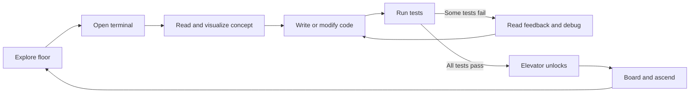
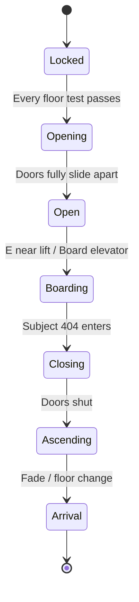
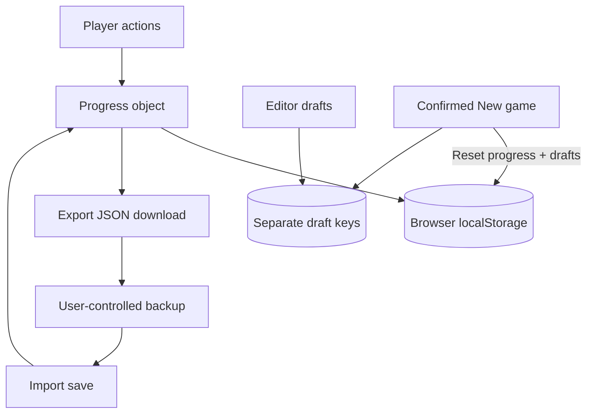

# CodeBreak: The Tower of Code — Player & User Manual

> **Manual edition:** 1.0  
> **Applies to:** CodeBreak `v1.2.0-rc.2` / Git tag `v1.2.0-rc.2` / commit `82d13ba`  
> **Release type:** Tested source-code *release candidate*, not a publicly hosted production service  
> **Audience:** First-time programmers, returning learners, teachers, and game testers  
> **Last reviewed:** 27 October 2026

---

## Contents

1. [Welcome and learning outcomes](#1-welcome-and-learning-outcomes)
2. [What you need](#2-what-you-need)
3. [Start the game](#3-start-the-game)
4. [Meet the cast and understand the story](#4-meet-the-cast-and-understand-the-story)
5. [Keyboard, mouse, and touch controls](#5-keyboard-mouse-and-touch-controls)
6. [How to complete a floor](#6-how-to-complete-a-floor)
7. [The nine-part learning method](#7-the-nine-part-learning-method)
8. [Code editor and grading](#8-code-editor-and-grading)
9. [Difficulty modes and diagnostic placement](#9-difficulty-modes-and-diagnostic-placement)
10. [All ten chapters](#10-all-ten-chapters)
11. [Progress, save files, replay, and restart](#11-progress-save-files-replay-and-restart)
12. [Your full-stack capstone](#12-your-full-stack-capstone)
13. [Troubleshooting](#13-troubleshooting)
14. [Accessibility, privacy, and safety](#14-accessibility-privacy-and-safety)
15. [Suggested study schedule](#15-suggested-study-schedule)
16. [Glossary](#16-glossary)
17. [Acceptance checklist](#17-acceptance-checklist)
18. [Appendix: complete floor index](#18-appendix-complete-floor-index)

---

## 1. Welcome and learning outcomes

**You play Subject 404:** a small white stickman trapped in a broken digital tower. An impatient companion, PATCH, teaches you to repair each floor by writing code. ROOT controls access; NULL and the missing Architect provide the mystery. The game blends a lighthearted tone with puzzles, exploration, and chapter endings.

There are **101 playable locations: Floor 0 (prologue) plus Floors 1–100**. The 100 numbered floors form ten chapters. At a chapter ending, you obtain a core. The final floor ends the central story.

You will **practice**, in sequence:

- JavaScript fundamentals and browser interaction.
- Semantic HTML and accessible page structure.
- CSS layout, responsive design, and styling.
- Asynchronous JavaScript, HTTP, and data exchange.
- Node.js, Express.js, and secure API concepts.
- SQL/PostgreSQL, authentication, JWT concepts, and integration.

**Scope matters:** The browser game teaches the later backend chapters through *models and simulations*. Its SQL floor checker validates recognizable SQL structure rather than executing a real database query. The **separate Tower Control System capstone** provides actual Node.js, Express.js, PostgreSQL, and JWT practice. Completing the story does **not** mean a player has passed a professional certification or independently deployed production software.

### The learning loop



## 2. What you need

### To play as a local user

- A desktop/laptop and a current Firefox or Chromium-based browser. This version has been exercised on Ubuntu with Firefox; other platforms and accessibility configurations require their own checks.
- **A running local Vite server**, if you are playing from the source checkout. Do not simply double-click `index.html` from the filesystem.
- Keyboard and mouse; on narrow/mobile screens there are on-screen directional and interaction controls, but mobile play remains a testing target.

### If you already have the source on Ubuntu

```bash
cd ~/Documents/codebreak
npm run dev
```

Open the **exact local URL** reported by Vite, normally `http://127.0.0.1:5173/`. Leave the terminal open while playing. Stop the server with `Ctrl+C` when finished.

### If you are installing from Git for the first time

```bash
git clone https://github.com/derrenderrick00-ux/codebreak.git
cd codebreak
git checkout v1.2.0-rc.2
npm ci
npm run dev
```

Use Node.js **20.19+** (the project's declared minimum); the maintainers' CI uses Node 22. Check with `node --version`. Run npm commands **from the directory containing `package.json`**. `npm ci` requires the committed lockfile and performs a clean dependency installation.

> **Data warning:** In-browser progress is not stored in Git or the project folder. Changing computers/browsers or clearing site data can lose it. Export progress JSON before resetting anything.

## 3. Start the game

1. Start the local server and open CodeBreak.
2. Read the **Subject 404** introduction.
3. Select **Start from Floor 0** if you are a beginner, or **Take skill assessment (8 questions)** if you have some JavaScript experience.
4. Enter Floor 0. Walk to the green coding terminal or choose **Open challenge** below the game.
5. Solve the identity problem, run tests, and board the elevator.
6. Continue floor-by-floor; your current location and progress appear at the top of the page.

### What is on screen?

| Element | Meaning / action |
|---|---|
| **Tower Feed** | The 2D Phaser world, Subject 404, terminal, platforms, and lift. |
| **Chapter title & Floor number** | Your current narrative location. |
| **Recovered cores** | How many chapter-ending rewards you earned (maximum 10). |
| **Floors cleared** | Passed numbered floors out of 100; Floor 0 is a prologue. |
| **Mode** | Guided, Practice, or Mastery. |
| **Open challenge** | Opens the lesson and code editor even when far from the terminal. |
| **Floor map** | Review/revisit **unlocked** floors. |
| **My progress** | Attempts, passes, mode, JSON export/import, reset. |
| **New game** | Starts a **destructive, confirmed** local reset. |
| **Sound** | Toggles optional game audio; the switch is saved locally. |
| **Controls** | Opens the in-game help dialog. |

## 4. Meet the cast and understand the story

- **Subject 404** — the playable stickman; starts without a recognized identity.
- **PATCH** — your sarcastic AI helper and source of mission guidance.
- **ROOT** — tower administrator, gatekeeper, and apparent antagonist.
- **NULL** — the elusive prior subject, visible in messages and lore.
- **The Architect** — missing creator whose unfinished system drives the plot.

The overall story is **The Tower of Code**. Your task is to restore ten interdependent systems and reach the top. For continuity, each chapter converts software ideas into visible tower problems: broken doors, unstable layouts, missing network signals, failing servers, restricted data vaults, and identity gates.

For a spoiler-light experience, read PATCH's dialogue and chapter arrival screens before opening the **Story archive** on the floor map. The finale appears after solving Floor 100 and completing its elevator sequence.

## 5. Keyboard, mouse, and touch controls

| Control | In the game world | Inside a code editor |
|---|---|---|
| `A` / `←` | Move left | Type `a` / move caret left |
| `D` / `→` | Move right | Type `d` / move caret right |
| `W` / `↑` | Jump | Type `w` / move caret up |
| `Space` | Jump | Insert a space |
| `Shift` | Sprint while moving | Normal Shift key behavior |
| `E` | Interact near terminal or lift | Type `e` |
| `Ctrl+Enter` (or `Cmd+Enter`) | — | Run the current tests |
| `Tab` | Browser focus navigation | Inserts two spaces in CodeBreak's textarea |
| `Esc` | Close an open dialog | Close an open dialog |
| Mouse click | Select UI buttons | Place caret, choose lesson panels/buttons |
| On-screen arrows / `JUMP` / `USE` | Mobile/narrow viewport controls | — |

**Important keyboard fix in `v1.2.0-rc.2`:** Phaser no longer captures movement/navigation keys globally while the programming dialog is open. If arrow keys or Space still control the stickman while editing, verify that you are on the correct tagged version and that the textarea has focus.

## 6. How to complete a floor

### Example: Floor 0 — *Subject Not Found*

1. Interact with the terminal (`E` nearby), or click **Open challenge**.
2. The left side contains the **nine lesson panels**. Read the objectives, definitions, steps, visualization, example, and applications.
3. The right side is an editable terminal. Floor 0 asks you to implement `identify(name)`.
4. A valid solution should **trim whitespace** and return `'Subject 404'` for an empty name. One example:

   ```javascript
   function identify(name) {
     const cleaned = name.trim();
     return cleaned ? cleaned : 'Subject 404';
   }
   ```

5. Select **Run tests**, or press `Ctrl+Enter`. The game evaluates several cases (normal name, padded name, blank name, empty string).
6. If any test fails, compare **expected** and **received** values, fix your code, and try again. Incorrect attempts do not take lives.
7. When all tests pass, the lift unlocks. Close the dialog and approach the lift with `E`, or click **Board elevator**.
8. Watch the doors open, Subject 404 approach and enter, the doors close, and the floor transition complete.

**Why test multiple cases?** A hard-coded answer might pass one demonstration but fail when the input changes. Use the lesson concepts to build a general solution.

### Elevator states



The game can display transit status such as **LIFT OPENING**, **SUBJECT 404 BOARDING**, and **ASCENDING TO NEXT FLOOR**. The elevator will not advance a floor that has not passed.

## 7. The nine-part learning method

Each floor applies the same learning structure:

| Step | Name | What you should do |
|---:|---|---|
| 1 | **Objectives** | Identify the concept and success criterion. |
| 2 | **Key definitions** | Understand the technical vocabulary. |
| 3 | **Step-by-step explanation** | Follow the reasoning; ask what changes at each step. |
| 4 | **Visualization** | Use **Previous/Next** to inspect the concept trace. |
| 5 | **Worked example** | Read an example and predict its output before checking. |
| 6 | **Real-life applications** | Connect the idea to actual websites and services. |
| 7 | **Exercise** | Work out a small problem independently. |
| 8 | **Mini-project** | Build a related small feature or function. |
| 9 | **Main project connection** | Understand how the idea supports the Tower Control System. |

The lesson panels expand/collapse. The interactive **concept trace** is an explanatory stepper, **not** a full JavaScript debugger or live CPU trace. Treat it as a thinking aid.

**Recommended habit:** predict → write → run → interpret feedback → fix → record the concept in your own words. If you solve a floor by copying the hint, replay it later without help.

## 8. Code editor and grading

### Editor features

- Real, accessible **textarea** for editing; a separate safe presentation layer displays syntax colors.
- Line numbers and line/character count.
- Highlight **On/Off** toggle.
- Automatic draft saving in local browser storage, keyed by floor (up to 12,000 characters for JS challenges).
- **Hint** reveals PATCH's lesson-specific suggestion.
- **Reset editor** restores the authored starter code (it does not erase overall game progress).
- `Ctrl+Enter` runs tests; `Tab` inserts two spaces.
- Test details show labels and expected/actual values where available.

### What each language checker actually does

| Floor kind | Actual behavior | Do not assume |
|---|---|---|
| **JavaScript** | Executes a named function against authored test cases in an isolated browser worker inside a sandboxed iframe; timed-out runs fail. | It is not a complete secure server-side code-grading service. |
| **HTML** | Parses markup and checks the presence of selected elements/attributes; provides a restricted preview. | It proves neither visual correctness nor full accessibility. |
| **CSS** | Parses stylesheet declarations and checks selected selectors/properties/values; provides a restricted preview. | It is not a pixel-perfect cross-browser layout grader. |
| **SQL** | Looks for required SQL syntax/clause structure in your text. | It **does not execute** statements in PostgreSQL. |
| **Node/Express/security-themed JavaScript floors** | Model server ideas using browser JavaScript functions. | They do **not** start a Node server, use live Express middleware, or verify production security. |

If you see an **infinite loop** timeout, inspect loop exit conditions and try again; the runner is expected to stop long-running JS. If the browser freezes despite the timeout, file a bug report.

## 9. Difficulty modes and diagnostic placement

### Modes (select from **My progress**)

- **Guided:** all explanations and available hints are easy to access.
- **Practice:** a lighter-prompt experience; the authored challenge tests are unchanged.
- **Mastery:** selected lesson panels, including examples/explanations, start **collapsed**, but you can still open them.

**These are presentation modes, not three different grading difficulties.** In the current release, all modes use the same challenge tests and the “passed” flag reflects passing those authored tests, not an external skills evaluation.

### Eight-question diagnostic

The prologue offers a small JavaScript multiple-choice placement check. Your score recommends a starting floor:

| Correct | Suggested floor |
|---:|---:|
| 0–1 | 1 |
| 2–3 | 2 |
| 4–5 | 4 |
| 6–7 | 6 |
| 8 | 8 |

It **unlocks access through the recommended floor** but **does not mark those floors passed or mastered**. You can still revisit Floor 0 or earlier unlocked levels. It is an introductory placement tool, not a full-stack pretest.

## 10. All ten chapters

| Chapter | Floors | Theme | Principal skills | Award |
|---|---:|---|---|---|
| 1 — The Awakening | 1–10, plus Floor 0 | Logic restoration | Functions, values, conditions, arrays, strings, loops | Logic Core |
| 2 — The Invisible Structure | 11–20 | Tower blueprint | Semantic HTML, forms, headings, links | Structure Core |
| 3 — The Architect's Lab | 21–30 | Visual systems | CSS, Flexbox, Grid, responsive rules | Design Core |
| 4 — The Living Machine | 31–40 | Dynamic rooms | DOM and browser interaction models | Interaction Core |
| 5 — The Signal Network | 41–50 | Communication | HTTP, JSON, promises, async concepts | Network Core |
| 6 — The Engine Room | 51–60 | Server power | Node.js/runtime concepts (browser-modelled) | Runtime Core |
| 7 — The Server Citadel | 61–70 | Service routes | Express, API and middleware concepts (browser-modelled) | API Core |
| 8 — The Memory Vault | 71–80 | Stored information | SQL/PostgreSQL concepts (structural SQL checks) | Memory Core |
| 9 — The Identity Gate | 81–90 | Access control | Authentication, authorization and JWT models | Security Core |
| 10 — The Final Deployment | 91–100 | Restoring the tower | Full-stack integration concepts and finale | Freedom Core |

**Chapter boss:** the final numbered floor of each chapter (10, 20, …, 100). **Story completion** follows clearing Floor 100 and reaching the finale. For real backend practice after the game, follow [Section 12](#12-your-full-stack-capstone).

## 11. Progress, save files, replay, and restart

### Automatic save

CodeBreak stores a local JSON record containing current/unlocked floors, floor passes, attempt counts, simple floor-level mastery flags, study mode, diagnostic result, and sound setting. Individual editor drafts are saved separately. The storage key is `codebreak:progress:v2`; drafts use `codebreak:draft:v1:<floor>`.

The **percentage** counts passed floors **1–100**. Passing Floor 0 alone does not increase the displayed 100-floor percentage. A diagnostic unlock may make a high floor accessible without increasing the cleared count; this is expected.

### Export progress (recommended after every chapter)

1. Select **My progress**.
2. Choose **Export save (JSON)**.
3. Save the downloaded file, typically named `codebreak-save-v2-compatible.json`.
4. Copy it to a safe location outside the project and browser profile.

**Export does not include per-floor editor drafts.** Copy important code into your own notes or repository before resetting browsers.

### Import progress

1. Open **My progress → Import save (JSON)**.
2. Select a CodeBreak-generated compatible JSON file (maximum upload size **128 KB**).
3. The game validates and normalizes supported fields; incompatible save versions are rejected.
4. Verify the current floor, completed count, and mode after import.

### Revisit / replay a floor

Open **Floor map**, expand a chapter, and select any **unlocked** floor. Completed floors can be revisited and the coding challenges retried. Locked floors cannot be chosen.

### Start a new game (destructive)

1. **Export save first.**
2. Select **↻ New game** in the header (or **My progress → Reset progress**).
3. Review the confirmation dialog.
4. Select **Erase progress & start again** only if you want to reset all local floor progress, diagnostic placement, attempts, and editor drafts.
5. The game returns to Floor 0 and replays the introduction.

Downloaded JSON exports are not deleted by this action. A new game affects this browser's local CodeBreak state, not a cloud account.

### Save-system diagram



## 12. Your full-stack capstone

The **Tower Control System** under `capstone/` is a **separate local application**, intended for learners progressing beyond browser simulations. It has a frontend dashboard and an Express API backed by PostgreSQL.

When a developer/teacher starts it locally, learners can:

1. Register with an email, display name, and **12+ character password**.
2. Log in and receive a **30-minute JWT**.
3. View their own identity through `/api/me`.
4. Create, list, update, and delete their own tower cores.
5. Observe that one authenticated account cannot modify another account's cores.

It is **not** automatically launched or synchronized with CodeBreak floor progress. You need Node.js, a local PostgreSQL service (or Docker), the server dependencies, environment configuration, and a database migration. See the **Developer Manual** for exact setup and security caveats. **Do not expose the demo capstone to the public Internet.**

## 13. Troubleshooting

| Symptom | Most likely reason | What to do |
|---|---|---|
| `npm ERR! ENOENT ... package.json` | Terminal is in the wrong directory, e.g. `~/Downloads`. | `cd ~/Documents/codebreak && ls package.json && npm run dev`. |
| Browser cannot connect to `127.0.0.1:5173` | Dev server has stopped. | Start `npm run dev` and use the exact address it prints. |
| Blank or frozen Tower Feed | Game engine failed to load or browser issue. | Reload once; check browser developer console and terminal; report errors. |
| Space/arrow keys move character while typing | Old version or editor not focused. | Confirm version `1.2.0-rc.2` and click inside the code textarea. |
| Character won't move | Lesson/help dialog remains open. | Close modal (`Esc` or X), then focus the game. |
| Elevator remains locked | Challenge not passed on current floor. | Run the tests, examine failures, fix solution, retry. |
| Elevator won't advance | Boarding incomplete, wrong position, or animation defect. | Use **Board elevator** after a pass or walk to lift + `E`; record any reproducible stall. |
| `Compilation: unexpected token` | Syntax error in submitted JS. | Check braces, quotes, function signature, and missing operators. |
| Execution timed out | Infinite loop or slow user code. | Check the loop condition, recursive base case, or async behavior. |
| HTML/CSS challenge fails despite good design | Structural checker expects specific elements or declarations. | Read the authored test labels; avoid treating passing as exhaustive visual correctness. |
| SQL says passed but query may be wrong | Only static SQL structure is checked. | Run equivalent SQL in the real PostgreSQL capstone before trusting behavior. |
| Progress disappeared | Browser data cleared/private mode/new browser/blocked storage. | Import previously exported progress JSON; no server-side recovery exists. |
| `git` commands fail | Version control is for source, not required to play. | Ask a maintainer or consult Developer Manual; don't delete `.git`. |
| Warning about 500 KB chunk | Bundler warns about a lazily loaded Phaser chunk. | This is **not a build failure**; developer release budgets and FPS testing are separate. |

When reporting a bug, include: **floor number, browser/version, OS, what you clicked, expected result, actual result, console error (if any), and whether the issue repeats after reload**. Do not include passwords, JWTs, `.env` content, or private save data in public reports.

## 14. Accessibility, privacy, and safety

- The challenge UI includes labeled buttons, modal dialogs, live status feedback, and a textarea for keyboard editing. Focus management and keyboard routing have been improved, but full accessibility certification has **not** been performed.
- You can use the **Open challenge** button instead of walking to the terminal. Controls/help and sound settings are visible in the header.
- The game supports narrow-screen touch buttons, but a small-screen usability audit remains a separate task.
- Local saves and drafts reside in your browser profile and are **not** automatically uploaded to the capstone API or GitHub.
- User-submitted code runs in a restricted browser environment for ordinary exercises. This is still a learning sandbox, not a guarantee that arbitrary hostile code has undergone formal isolation testing.
- Do not enter real passwords, secrets, access tokens, private customer data, or credentials into game exercises.
- The capstone is a local teaching application, not a hardened Internet service.

## 15. Suggested study schedule

If you have **30 minutes per day**, use this repeatable session:

- **5 minutes:** revisit yesterday's concept; predict a result.
- **10 minutes:** read the floor lesson and use the concept visualization.
- **10 minutes:** solve, test, and debug the challenge.
- **5 minutes:** rewrite the solution without hints or note what failed.

When a chapter ends, take an additional session to build its mini-project outside the game. If the lesson is too challenging, replay earlier floors rather than rushing for a completion percentage.

For full-stack career preparation, the game should lead into independent practice, code reviews, automated tests, databases, authentication, deployment, and maintaining a real application.

## 16. Glossary

| Term | Meaning |
|---|---|
| **Floor** | A playable coding mission. |
| **Core** | Chapter-ending story reward. |
| **PATCH** | In-game guide / dialogue companion. |
| **Diagnostic** | Eight-question JavaScript placement assessment. |
| **Mode** | Presentation choice: Guided, Practice, or Mastery. |
| **Test case** | A prescribed input and expected result or structure requirement. |
| **Caret** | The text cursor inside the code editor. |
| **Sandbox** | Restricted environment used to run learner code. |
| **DOM** | Browser's document structure API. |
| **CSSOM** | Browser-parsed stylesheet representation. |
| **HTTP** | Request/response protocol between clients and servers. |
| **API** | Interface by which one software component calls another. |
| **Node.js** | Server-side JavaScript runtime. |
| **Express.js** | Node.js web server framework. |
| **PostgreSQL** | Relational database system. |
| **JWT** | Signed token often used to carry authenticated claims. |
| **localStorage** | Browser storage tied to an origin/browser profile. |
| **Capstone** | Larger practical project connecting several skills. |

## 17. Acceptance checklist

Use this checklist before declaring your personal installation ready:

- [ ] Game loads and introduction is visible on a fresh profile.
- [ ] Subject 404 moves, jumps, interacts, and does not fall through the floor.
- [ ] Editor accepts Space and all four arrow keys.
- [ ] Running wrong code shows understandable failures.
- [ ] Running correct code unlocks a floor.
- [ ] Elevator doors visibly open; character enters; doors close; next floor loads.
- [ ] Learning panels and Previous/Next concept trace respond.
- [ ] Save survives refresh; export/import JSON works.
- [ ] New Game confirmation works; restart returns to Floor 0.
- [ ] The selected floor, chapter, and counters are sensible.
- [ ] At least one HTML, CSS, JS, and SQL exercise is tested.
- [ ] The real capstone's separate requirements are understood.


## 18. Appendix: complete floor index

> **Spoiler notice:** This lists the mission titles of every floor. Each entry below was extracted from the source data for the tagged release. The **Type** column names the actual browser exercise validator (`JS`, `HTML`, `CSS`, `SQL`), not a separate live backend runtime.

| Floor | Chapter | Mission | Topic | Type |
|---:|---:|---|---|---|
| 0 | 1 | Subject Not Found | First contact · functions | JS |
| 1 | 1 | The Dead Generator | Variables · values · operators | JS |
| 2 | 1 | The Suspicious Door | Conditionals · Boolean logic | JS |
| 3 | 1 | Signal Lost | if / else · truth and choices | JS |
| 4 | 1 | Steps to Freedom | Loops · counters | JS |
| 5 | 1 | Power Redistribution | Arrays · .map() | JS |
| 6 | 1 | The Three-Door Protocol | Objects · search · arrays | JS |
| 7 | 1 | The Broken Transmission | Strings · methods | JS |
| 8 | 1 | The Function Factory | Functions · parameters · defaults | JS |
| 9 | 1 | The Array of Broken Modules | Array methods · filter | JS |
| 10 | 1 | THE INFINITE LOOP | Boss · loops · conditions · edge cases | JS |
| 11 | 2 | The Skeleton | HTML document anatomy | HTML |
| 12 | 2 | The Beacon | Semantic landmarks | HTML |
| 13 | 2 | The Jump Link | Links and fragments | HTML |
| 14 | 2 | The Signal Form | Labels and inputs | HTML |
| 15 | 2 | Inventory Table | Tables with headers | HTML |
| 16 | 2 | Mission List | Ordered and unordered lists | HTML |
| 17 | 2 | Accessible Comms | Accessible images and buttons | HTML |
| 18 | 2 | The Status Panel | Forms and validation | HTML |
| 19 | 2 | The Blueprint | Metadata and sections | HTML |
| 20 | 2 | THE BROKEN BLUEPRINT | Semantic dashboard boss | HTML |
| 21 | 3 | Color the Dark | Color and background | CSS |
| 22 | 3 | The Box Model | Padding and borders | CSS |
| 23 | 3 | Align the Cores | Flexbox | CSS |
| 24 | 3 | The Grid Chamber | Grid tracks | CSS |
| 25 | 3 | Selector Security | Classes and pseudoclasses | CSS |
| 26 | 3 | Readable Signals | Typography | CSS |
| 27 | 3 | A Responsive Exit | Responsive media queries | CSS |
| 28 | 3 | Emergency Motion | Transitions | CSS |
| 29 | 3 | Focus Protocol | Visible keyboard focus | CSS |
| 30 | 3 | THE LAYOUT SHIFTER | Responsive control dashboard | CSS |
| 31 | 4 | The Selector | DOM targeting | JS |
| 32 | 4 | Text Repair | textContent | JS |
| 33 | 4 | Class Toggler | Class lists | JS |
| 34 | 4 | Event Firewall | Event handling | JS |
| 35 | 4 | The Form Gate | Form validation | JS |
| 36 | 4 | Inventory Renderer | Rendering lists | JS |
| 37 | 4 | State Switch | UI state | JS |
| 38 | 4 | The Filter Panel | Filtering | JS |
| 39 | 4 | Local Save Core | JSON serialization | JS |
| 40 | 4 | THE EVENT STORM | Combined UI logic | JS |
| 41 | 5 | JSON Signal | JSON parsing | JS |
| 42 | 5 | Promise Relay | Promises | JS |
| 43 | 5 | Wait for Signal | async/await | JS |
| 44 | 5 | HTTP Status | HTTP response codes | JS |
| 45 | 5 | Packet Decoder | API response shapes | JS |
| 46 | 5 | Retry Channel | Retry decisions | JS |
| 47 | 5 | Concurrent Relay | Promise.all | JS |
| 48 | 5 | Query Builder | URLSearchParams | JS |
| 49 | 5 | Envelope Guard | API validation | JS |
| 50 | 5 | THE TIMEOUT PHANTOM | Resilience | JS |
| 51 | 6 | Environment Reader | Environment configuration | JS |
| 52 | 6 | Path Normalizer | Filesystem paths | JS |
| 53 | 6 | Module Registry | Modules | JS |
| 54 | 6 | Packet Buffer | Bytes | JS |
| 55 | 6 | Log Formatter | Structured logs | JS |
| 56 | 6 | Port Guardian | Ports | JS |
| 57 | 6 | Config Merge | Server configuration | JS |
| 58 | 6 | Process Exit | Process signals | JS |
| 59 | 6 | Dependency Guard | Package versions | JS |
| 60 | 6 | THE CRASHED ENGINE | Server health | JS |
| 61 | 7 | Route Finder | REST routing | JS |
| 62 | 7 | Request Parser | Request validation | JS |
| 63 | 7 | Response Codes | REST conventions | JS |
| 64 | 7 | Middleware Chain | Middleware ordering | JS |
| 65 | 7 | Query Gateway | Query parameters | JS |
| 66 | 7 | Error Sanitizer | Error handling | JS |
| 67 | 7 | API Envelope | Response formats | JS |
| 68 | 7 | Input Whitelist | Mass assignment prevention | JS |
| 69 | 7 | CORS Policy | Origin controls | JS |
| 70 | 7 | THE ROUTE GUARDIAN | Express API integration | JS |
| 71 | 8 | Create the Memory | CREATE TABLE | SQL |
| 72 | 8 | Insert a Core | INSERT INTO | SQL |
| 73 | 8 | Read the Cores | SELECT | SQL |
| 74 | 8 | Find Offline Systems | WHERE | SQL |
| 75 | 8 | Repair a Row | UPDATE | SQL |
| 76 | 8 | Remove a Broken Core | DELETE | SQL |
| 77 | 8 | Link the Memory | FOREIGN KEY | SQL |
| 78 | 8 | Join the Records | JOIN | SQL |
| 79 | 8 | Count the Damage | GROUP BY | SQL |
| 80 | 8 | THE DATA WRAITH | SQL transaction | SQL |
| 81 | 9 | Password Policy | Credential rules | JS |
| 82 | 9 | Access Matrix | Authorization | JS |
| 83 | 9 | Rate Limit | Abuse mitigation | JS |
| 84 | 9 | JWT Claims | JWT claim validation | JS |
| 85 | 9 | Permission Check | Least privilege | JS |
| 86 | 9 | Sensitive Fields | Data minimization | JS |
| 87 | 9 | Secret Redactor | Log sanitation | JS |
| 88 | 9 | Session Expiry | Session management | JS |
| 89 | 9 | Role Hierarchy | Authorization roles | JS |
| 90 | 9 | THE IMPOSTOR | Security integration | JS |
| 91 | 10 | Capstone Inventory | Data modelling | JS |
| 92 | 10 | Dashboard Aggregation | KPIs | JS |
| 93 | 10 | Search Endpoint | Filtering and pagination | JS |
| 94 | 10 | Dashboard Permissions | API access control | JS |
| 95 | 10 | API Contract | Request payload validation | JS |
| 96 | 10 | Restore Transaction | Atomic updates model | JS |
| 97 | 10 | Health Endpoint | Monitoring | JS |
| 98 | 10 | Deployment Config | Production configuration | JS |
| 99 | 10 | Integration Gate | Release readiness | JS |
| 100 | 10 | ROOT / FINAL DEPLOYMENT | Full-stack system verification | JS |

---

**Support reference:** [CodeBreak source repository](https://github.com/derrenderrick00-ux/codebreak) · [Tagged release source](https://github.com/derrenderrick00-ux/codebreak/tree/v1.2.0-rc.2)  
**Companion document:** `DEVELOPER_MAINTAINER_MANUAL.md` (setup, architecture, testing, security, and release operations).
